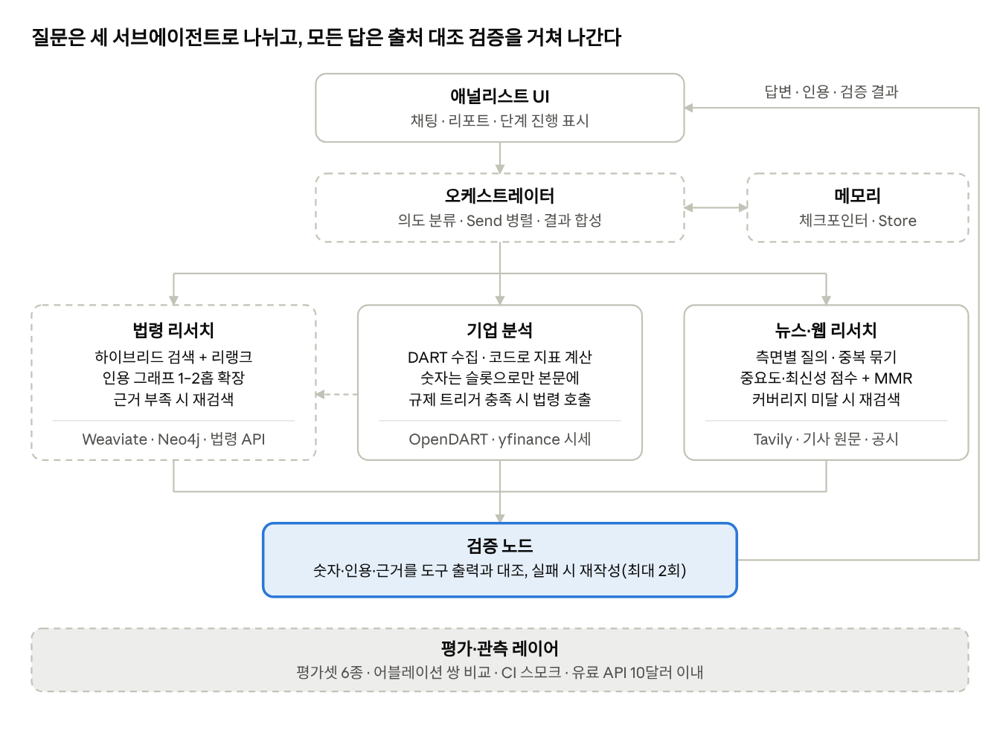
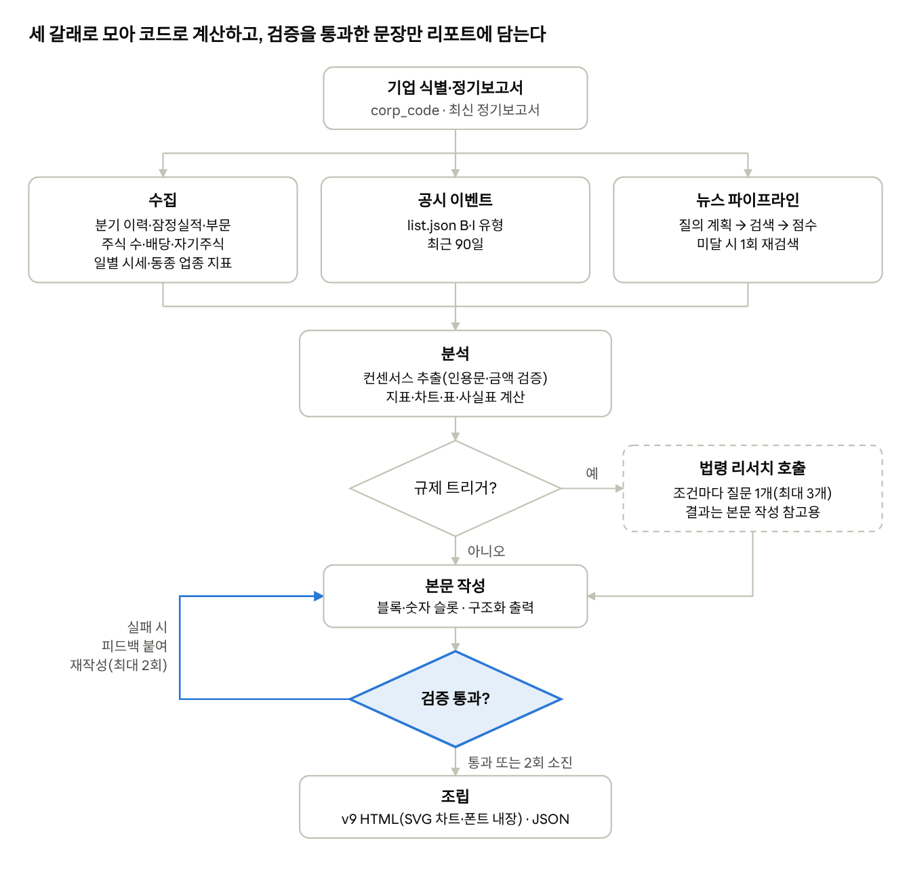
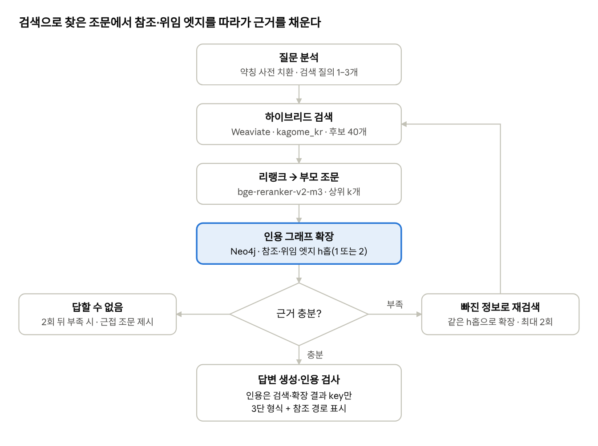

# Finsight v2 구현 설계서

정본은 [Claude Docs의 설계서](https://claude.ai/code/artifact/57ce8521-8362-43c4-a254-ebfa8ead32c7)이고, 이 파일은 2026-10-12에 내보낸 사본이다. 둘이 다르면 정본을 따른다.

## 한눈에 보기

Finsight v1(해커톤 버전)을 핵심 로직, 기술 스택, 에이전트 설계, 정량 평가 네 방향으로 고도화하는 v2의 구현 설계다. 재무 숫자는 OpenDART 응답과 시세에서 코드가 계산하고, 법령 간 참조는 적재할 때 Neo4j 엣지로 만들며, 모든 변경은 고정된 평가셋에서 직전 구성과 짝지어 비교한다. 내용은 레포 커밋 `5c23985` 기준이고, 일정과 우선순위는 이 문서에서 정하지 않는다.



강조한 상자는 검증 노드다. 점선 상자는 아직 코드가 없는 부분이고, 점선 화살표는 기업 분석이 규제 트리거를 충족할 때만 법령 리서치를 부른다는 뜻이다. 리포트 화면은 오케스트레이터를 거치지 않고 기업 분석 그래프를 바로 부른다(`GET /report/{corp_code}`). 지금 동작하는 것은 기업 분석 리포트 v2와 그 안의 뉴스 파이프라인·검증 노드다.

## 설계 원칙과 범위

v2의 설계 결정은 아래 네 원칙 중 하나로 설명된다.

1. **숫자는 코드가 계산한다.** 재무 수치는 OpenDART 구조화 응답과 시세에서 코드로 계산한다. LLM은 본문에 숫자를 직접 쓰지 않고 `{{opm.3Q26P}}` 같은 슬롯을 쓰며, 렌더러가 슬롯을 계산값과 출처 툴팁으로 바꾼다.
2. **참조는 적재할 때 연결한다.** 법령 간 참조·위임은 적재 시점에 그래프 엣지로 만들고, 질의 시점에는 검색된 조문에서 엣지를 1–2홉 따라가 관련 조문을 더한다. v1처럼 LLM이 조문명을 생성해 이름으로 찾는 단계는 없다.
3. **리포트는 워크플로, 채팅은 에이전트.** 리포트는 노드 순서가 고정된 그래프다. 순서에서 벗어나는 곳은 뉴스 커버리지 미달 시 재검색(최대 1회), 규제 트리거 충족 시 법령 서브그래프 호출, 검증 실패 시 블록 재작성(최대 2회) 세 곳이다. 채팅은 오케스트레이터가 질문 의도로 서브에이전트를 고르고, 뉴스·웹 서브에이전트는 쓸 도구를 스스로 고른다.
4. **측정 없는 변경은 없다.** 변경 하나를 어블레이션 설정 하나로 만들고, 같은 평가셋 문항에서 직전 설정과 짝지어 비교한다. v1과는 비교하지 않고, v1 코드는 git 태그 `v1-hackathon`으로 남긴다.

범위 밖:

- 프론트엔드 재설계. 바꾸는 것은 리포트 v2 HTML 표시, `POST /chat` SSE 수신(진행 표시, 초안을 검증본으로 교체, 후보 선택과 재개), 모드 드롭다운의 자동·법령·기업·뉴스 네 선택지, `thread_id`·`user_id` UUID의 localStorage 저장뿐이다.
- 로그인·권한 체계. `/admin/*`를 `X-Admin-Token` 헤더로 보호하는 것만 포함한다.
- 전자금융 법령 밖으로의 코퍼스 확장. 판례·해석례도 적재하지 않는다.
- 투자 권유. 매수·매도 의견, 목표주가, 실적 전망은 쓰지 않는다.

## 코드 구조

백엔드는 외부 클라이언트(`core`), I/O 없는 순수 로직(`domain`), LangGraph 그래프(`agents`), HTTP 계층(`api`)으로 나눈다. 계산·계정 매핑·참조 해석·뉴스 점수는 `domain`에 두어 외부 호출 없이 단위 테스트한다. 아래 트리는 지금 있는 v2 파일이고, 설계만 있는 모듈은 그 아래 표에 적는다.

```text
backends/
├── app/
│   ├── main.py               # FastAPI. lifespan에서 httpx·OpenDART 클라이언트와 기업 분석 그래프 생성
│   ├── settings.py           # pydantic-settings (환경 변수, backends/.env)
│   ├── deps.py               # AppState 주입
│   ├── api/
│   │   ├── report.py         # GET /report/{corp_code}, /json, /stream
│   │   └── financial.py      # POST /financial/corp_list
│   ├── core/
│   │   ├── llm.py            # Claude 호출(structured·cited·text), 에이전트 모델
│   │   ├── budget.py         # 비용 장부, 예산·검색 크레딧·요청 토큰 상한
│   │   ├── cache.py          # CacheBackend와 SQLite 구현
│   │   ├── embeddings.py     # bge-m3 임베딩(OpenRouter)
│   │   ├── market.py         # yfinance 일별 종가·분할 이력·지수·우선주
│   │   ├── peers.py          # 동종 업종 후보와 ROE·PBR·PER
│   │   ├── dart/
│   │   │   ├── client.py     # OpenDART HTTP, 상태 코드, 재시도, 장애 시 지난 응답
│   │   │   ├── corp.py       # 기업 식별·기업개황
│   │   │   ├── filings.py    # 최신 정기보고서, 최근 90일 공시
│   │   │   ├── financials.py # fnlttSinglAcntAll → FinancialSnapshot
│   │   │   ├── history.py    # 2016년~ 분기 손익·자본, 누적 현금흐름 항목
│   │   │   ├── prelim.py     # 영업(잠정)실적 목록·원문 표
│   │   │   ├── segments.py   # 사업부문별 요약 재무 현황
│   │   │   ├── shares.py     # 주식 총수·배당·자기주식 취득 결정
│   │   │   └── viewer.py     # DART 원문 뷰어(목차·EUC-KR)
│   │   └── search/
│   │       ├── tavily.py     # Tavily /search, 크레딧 장부
│   │       ├── news.py       # 뉴스·웹 검색
│   │       └── extract.py    # 본문 보충 추출(trafilatura)
│   ├── domain/
│   │   ├── models.py         # Pydantic 도메인 모델
│   │   ├── accounts.py       # 계정 매핑
│   │   ├── metrics.py        # 스냅샷 지표 계산(리포트 v2는 쓰지 않는다)
│   │   ├── binding.py        # 슬롯 치환·검사, 조사·방향어 다듬기
│   │   ├── fmt.py            # 표기(조원·억원·배·%p)
│   │   ├── news_rank.py      # 중복 묶기·점수·MMR
│   │   ├── sources.py        # 출처 등급, 매체 이름
│   │   ├── dates.py          # 발행일 파싱·KST
│   │   └── ksic.py           # 업종 표, 차트용 짧은 업종명
│   └── agents/
│       ├── company/          # graph, nodes, state, collect, analysis, writer, render
│       ├── news/pipeline.py  # 리포트용 뉴스 파이프라인
│       └── verifier.py       # 검증 노드
├── assets/fonts/             # Pretendard KS X 1001 부분 글꼴 4종 + OFL.txt
├── data/universe.json        # 동종 업종 후보(상장사 2,632곳)
├── data/law_pdfs/            # 법령 원문 PDF(뷰어용)
├── scripts/                  # build_universe.py, add_universe_mcap.py
├── eval/results/v1-legacy/   # v1 평가 CSV
└── tests/                    # 5개 파일, 50개
```

| 설계만 있는 모듈 | 내용 | 절 |
| --- | --- | --- |
| `core/law/`(lawgo\_client, parser, pdf\_ingest, pdf\_pages, vector\_store, graph\_store), `core/reranker.py`, `domain/citations.py`, `scripts/ingest_law.py` | 법령 적재·검색·인용 그래프 | 법령 리서치 에이전트 |
| `agents/legal/` | 법령 서브그래프와 도구 | 법령 리서치 에이전트 |
| `agents/orchestrator/`, `agents/news/graph.py`·`tools.py`, `memory/` | 라우터·합성, 뉴스·웹 에이전트, 체크포인터·Store | 오케스트레이터와 채팅 |
| `api/chat.py`, `api/documents.py`, `api/admin.py`, `api/legacy.py` | 채팅 SSE, 업로드 문서, 법령 적재, v1 경로 호환 | API 계약 |
| `eval/`(datasets, configs, cassettes, metrics, runners) | 평가셋과 러너 | 평가 설계 |

v1 파일 중 `core/llm/llm.py`, `core/VDB/`, `core/Preprocessor/`, `core/web_search_agent/`, `routers/`, `schemas/`, `services/`, `charts.py`, `pdfs/`는 레포에 남아 있지만 v2 앱에 연결돼 있지 않다. 법령·채팅을 옮기면서 위 표의 모듈로 바꾸고 지운다. SearchApi 키가 든 `test_web_agent.py`, 노트북, 레포 루트의 `main.py`·`requirements.txt` 삭제와 v1 결과 CSV 이동은 커밋 `fab3d38`에서 했다.

### 주요 도메인 모델 (`domain/models.py`)

| 모델 | 핵심 필드 | 쓰는 곳 |
| --- | --- | --- |
| `CorpProfile` | corp\_code, corp\_name, stock\_code, corp\_cls, induty\_code, acc\_mt | 기업 식별 |
| `PeriodicFiling` | rcept\_no, report\_nm, rcept\_dt, bsns\_year, reprt\_code | 최신 정기보고서, 리포트 캐시 키 |
| `Disclosure` | rcept\_no, report\_nm, rcept\_dt, pblntf\_ty | 공시 목록, 뉴스 점수, 규제 트리거 |
| `FinancialSnapshot` | rcept\_no, bsns\_year, reprt\_code, fs\_div, lines(`FinancialLine`) | 분기 이력 |
| `Metric` | id, label, period, value, unit, formula, inputs, note, text, source | 사실표 |
| `NewsItem` | id, title, url, source, published\_at, aspect, materiality, analysis | 뉴스 목록, 본문 인용 |
| `Claim` | id, text, metric\_ids, news\_ids, legal\_keys | 검증 단위 |
| `ReportDraft`, `Block`, `Headline` | 본문 작성 절 | 리포트 본문 |
| `VerificationResult` | passed, issues(claim\_id, type, detail) | 검증 노드 |
| `LegalFinding` | question, answer(`LegalAnswer`) | 규제 트리거 결과 |
| `CompanyReport` | corp, filing, latest, fs\_div, metrics, data, draft, verification, disclosures, news, news\_note, regulatory, citations, errors, cost\_usd | `/report/{corp_code}/json` |
| `Article`, `Annex`, `ArticleHit`, `LegalAnswer`, `Citation`, `SubResult`, `NewsFindings` | 법령·채팅 절 | 모델만 있고 쓰는 코드는 없다 |

## 공통 기반

외부 클라이언트와 컴파일된 그래프는 앱 시작 시 한 번 만들어 주입하고, Claude 호출은 모두 `core/llm.py`를 거친다. 유료 호출은 비용 장부에 적고, 예산을 넘으면 새 호출을 막는다.

### 설정 (`settings.py`)

값은 환경 변수나 `backends/.env`에서 읽는다(목록은 `backends/.env.copy`). 키는 `SecretStr`로 받아 로그·오류 메시지·출력에 남기지 않는다.

| 변수 | 용도 |
| --- | --- |
| `ANTHROPIC_API_KEY` | 생성 모델(Claude) |
| `LLM_MODEL`, `LLM_MODEL_STRONG` | `claude-haiku-5-5`(기본), `claude-sonnet-5-5`(생성 모델 비교 실험 전용) |
| `OPENROUTER_KEY`, `OPENROUTER_BASE_URL` | 임베딩(bge-m3)과 judge |
| `LLM_MODEL_JUDGE` | 평가용 judge 모델(OpenRouter, Claude가 아닌 계열) |
| `EMBEDDING_MODEL` | `baai/bge-m3`(1024차원) |
| `OPENDART_API_KEY` | OpenDART |
| `TAVILY_API_KEY`, `TAVILY_MAX_CREDITS` | 뉴스·웹 검색, 프로젝트 누적 검색 크레딧 상한(기본 300) |
| `LAW_OC` | 국가법령정보 Open API |
| `WEAVIATE_URL`, `NEO4J_URI`, `NEO4J_USER`, `NEO4J_PASSWORD` | 법령 저장소 |
| `SQLITE_PATH` | 체크포인터·Store |
| `ADMIN_TOKEN`, `CORS_ORIGINS` | `/admin/*` 인증 토큰, 허용 출처(쉼표 구분) |
| `CACHE_DIR`, `LLM_CACHE` | 캐시·비용 장부 SQLite 위치, LLM 응답 캐시 사용(평가 실행에서만 `true`) |
| `BUDGET_USD` | 유료 API(Claude, OpenRouter, Tavily) 누적 비용 상한(기본 9.0) |
| `REQUEST_TOKEN_BUDGET` | 요청 하나의 Claude 입력+출력 토큰 상한(기본 300,000) |
| `LANGSMITH_TRACING`, `LANGSMITH_API_KEY`, `LANGSMITH_PROJECT` | 트레이싱 |

### Claude 호출 (`core/llm.py`)

생성은 Claude API, 임베딩과 judge는 OpenRouter를 쓴다. 유료 API 예산이 개발과 평가를 합쳐 10달러라서 생성은 Haiku 5.5로 하고, Sonnet 5.5는 생성 모델 비교 실험에만 쓴다. 노드는 Anthropic SDK(`AsyncAnthropic`)를 직접 부르고, LangChain `ChatAnthropic`은 채팅의 뉴스·웹 에이전트에만 쓴다. 인용·구조화 출력·캐싱·effort를 래퍼 지원 여부와 상관없이 쓰기 위해서다.

```python
async def structured(schema, messages, *, role="default", effort="low", system=None,
                     max_tokens=None, task="structured", validate=None, thinking=True) -> T:
    # messages.parse(output_format=schema). max_tokens가 8,000을 넘으면 messages.stream으로 받는다
    # 스키마 위반·validate 실패·refusal → 같은 설정으로 1회, max_tokens 중단 → 2배로 1회 → StructuredOutputError
    # thinking=False → thinking={"type": "disabled"}

async def cited(question, docs, *, effort="medium", max_tokens=16_000) -> Message:
    # search_result 블록 + citations. 마지막 조문 블록에만 cache_control

async def text(messages, *, effort="low", system=None) -> str      # 대화 요약 등
def agent_model(effort="medium") -> ChatAnthropic                  # 뉴스·웹 에이전트
```

effort별 기본 max\_tokens는 low 4,000, medium 8,000, high 16,000이고 적응형 사고 토큰도 여기에 들어간다.

| 작업 | effort | max\_tokens | 쓰는 기능 | 상태 |
| --- | --- | --- | --- | --- |
| 뉴스 질의 계획, 기사 분류, 리포트 컨센서스 추출 | low | 4,000 | 구조화 출력(기사 분류는 프롬프트 캐싱) | 구현 |
| 기사 요약·영향, 규제 질문 작성, 주장 지지·투자 권유 판정 | medium | 8,000 | 구조화 출력 | 구현 |
| 리포트 본문 작성·재작성 | medium, 생각 끔 | 12,000 | 구조화 출력(스트리밍), 프롬프트 캐싱 | 구현 |
| 라우팅·지시문 재작성, 대화 요약, `NewsFindings` 변환 | low | 4,000 | 구조화 출력, 텍스트 | 설계 |
| 법령 질문 분석·충분성 판단 | medium | 8,000 | 구조화 출력 | 설계 |
| 법령 답변 | medium | 16,000 | `search_result` 인용, 프롬프트 캐싱 | 설계 |
| 뉴스·웹 에이전트 | medium | 8,000 | 도구 호출(`ChatAnthropic` + `create_agent`) | 설계 |
| 채팅 답변 합성·재작성 | high | 16,000 | 구조화 출력, 프롬프트 캐싱 | 설계 |
| 평가셋 라벨 초안 | medium | 8,000 | 구조화 출력, Message Batches | 설계 |
| 생성 모델 비교(평가 전용, Sonnet 5.5, 법령 답변 30문항) | medium | 16,000 | `search_result` 인용 | 설계 |
| judge(평가 전용, `LLM_MODEL_JUDGE`) | — | — | 구조화 출력 | 설계 |

effort는 초깃값이다. 작업마다 low·medium·high를 dev 분할에서 돌려, 그 작업이 영향을 주는 지표(라우팅 → macro-F1, 기사 분류 → 뉴스 nDCG@5, 법령 질문 분석·답변 → 정답성, 리포트 본문 → 주장 지지율)가 최고값보다 1%p 넘게 낮지 않은 가장 낮은 effort를 쓴다. 리포트 본문만은 측정으로 정했다: 같은 입력에서 high는 생각만으로 32,000토큰 한도를 두 번 넘겼고, low는 18,223토큰·73초, 생각을 끈 medium은 4,736토큰·25초였다.

| 모델(USD / 100만 토큰) | 입력 | 출력 | 캐시 쓰기(5분) | 캐시 읽기 | 배치 입력·출력 |
| --- | --- | --- | --- | --- | --- |
| Sonnet 5.5 | 2 | 10 | 2.50 | 0.10 | 1 · 5 |
| Haiku 5.5(프롬프트 10만 토큰 이하) | 0.10 | 0.50 | 0.125 | 0.01 | 0.05 · 0.25 |
| Haiku 5.5(프롬프트 10만 토큰 초과) | 0.50 | 2.50 | 0.625 | 0.05 | 0.25 · 1.25 |

- `temperature`·`top_p`·`top_k`는 보내지 않는다(기본값과 다르면 400). 같은 입력에 같은 출력을 얻는 일은 응답 캐시가 맡는다.
- 구조화 출력은 `output_config.format`(SDK `messages.parse`)으로 받는다. Sonnet 5.5는 강제 도구 호출을 400으로 거부하므로 도구 강제 방식은 쓰지 않는다. 스키마에는 재귀 구조와 숫자·길이 제약을 넣지 않고, 개수 조건은 프롬프트로 지시한 뒤 `validate`로 검사한다.
- 인용(`search_result`)과 구조화 출력은 한 요청에 함께 쓸 수 없다(400). 법령 답변은 인용으로, 나머지는 구조화 출력으로 나눈다.
- 프리필은 400이므로 메시지 목록은 항상 user 턴으로 끝난다. 응답은 `thinking` 블록으로 시작할 수 있어 `content`는 `type`으로 골라 읽는다.
- 프롬프트 캐싱은 반복되는 앞부분의 끝에 `cache_control`을 하나 건다: 본문 작성·채팅 합성의 시스템 프롬프트, 기사 분류의 시스템 프롬프트, 법령 답변의 조문 블록. 512토큰 미만은 캐시되지 않고, 캐시는 마지막 사용 뒤 5분 유지된다.
- 호출마다 `usage`(입력·출력·캐시 쓰기·캐시 읽기 토큰)에 단가를 곱해 비용 장부에 적고, 리포트 1건의 비용을 `CompanyReport.cost_usd`로 돌려준다.
- 실패하면 `None` 대신 예외를 올린다. 노드는 예외를 잡아 `errors`에 "노드명: 메시지"를 더하고 자기 출력 키를 비운 채 넘긴다. 리포트는 자료가 없는 차트·표·절을 빼고 그린다.

### 예산과 비용 장부 (`core/budget.py`)

- 유료 호출(Claude, OpenRouter, Tavily) 직전에 장부의 누적 비용을 보고 `BUDGET_USD`를 넘었으면 `BudgetExceeded`를 올린다. 리포트 API는 402로 답한다.
- Tavily는 `include_usage=true`로 받은 `usage.credits`를 적는다. 앱 시작 시 `GET /usage`로 이번 결제 주기의 남은 플랜 크레딧(무료 플랜 월 1,000)을 읽어 그 안은 0달러, 넘는 크레딧은 1크레딧당 0.008달러로 센다. `/usage`를 못 읽으면 모두 0.008달러다. 누적 크레딧이 `TAVILY_MAX_CREDITS`에 닿으면 검색을 막는다(`SearchCreditsExceeded`).
- 요청 하나의 Claude 토큰 합이 `REQUEST_TOKEN_BUDGET`을 넘으면 새 LLM 호출을 멈춘다(`TokenBudgetExceeded`).
- 캐시에서 읽은 응답은 비용과 크레딧에 넣지 않는다. 현재 합계는 `GET /health/budget`이 보여 준다.

### 수명주기, 비동기, 트레이싱

- lifespan에서 캐시의 만료 항목을 지우고, 공유 `httpx.AsyncClient`(타임아웃 10초), OpenDART 클라이언트, 컴파일된 기업 분석 그래프를 만들어 `AppState`로 주입한다. Weaviate·Neo4j 클라이언트, 리랭커, 체크포인터·Store, 법령 서브그래프(`legal_runner`)는 법령·채팅을 구현할 때 같은 자리에 더한다.
- 라우터는 `async def`에서 `graph.ainvoke`·`astream`을 부르고, 동기 라이브러리(yfinance, PyMuPDF)는 `asyncio.to_thread`로 감싼다.
- 동시 호출 수: OpenDART 4, Tavily 4, 임베딩 4, 기사 본문 수집 8, Claude 8. Claude API 타임아웃은 120초다.
- LangSmith는 환경 변수로 LangGraph 노드를 기록하고, SDK 직접 호출은 `traceable`로 감싸 같은 트레이스에 넣는다. 실행 메타데이터에 `corp_code`를 붙인다.

### 캐시 (`core/cache.py`)

`CacheBackend` 인터페이스에 SQLite 구현을 둔다. `peek()`은 만료된 항목도 읽어, OpenDART가 실패할 때 지난 응답으로 대신하는 데(stale-if-error) 쓴다.

| 대상 | 네임스페이스 | 만료 |
| --- | --- | --- |
| 완성 리포트 | `report` | 7일. 키는 `v2:{corp_code}:{최신 정기보고서 rcept_no}:{최신 잠정실적 rcept_no}`. 본문까지 만든 리포트만 넣는다 |
| OpenDART 재무제표 | `dart.fin` | 없음 |
| OpenDART 원문 뷰어 | `dart.view` | 없음 |
| 주식 총수·배당 | `dart.sh` | 없음. 자기주식 취득 결정은 1시간 |
| 공시 목록 | `dart.list` | 1시간, 장애 시 지난 응답 |
| 기업개황 | `dart.company` | 1일, 장애 시 지난 응답 |
| 기업 고유번호 목록 | `dart.corplist` | 1일 |
| 일별 시세, 분할 이력 | `px`, `px.split` | 12시간, 1일 |
| 검색 결과 | `tavily` | 7일. 검색 크레딧을 아끼려고 길게 둔다 |
| 기사 본문 | `article` | 7일 |
| 임베딩 | `emb` | 없음 |
| LLM 응답 | `llm` | 없음. `LLM_CACHE=true`인 평가 실행에서만 읽고 쓴다 |
| 비용 장부 | 별도 표 | 없음. 누적 합계로 예산을 판정한다 |

### 보안

| 항목 | 상태 |
| --- | --- |
| SearchApi 키(v1 커밋 2a60b00부터 공개) | 키가 든 `test_web_agent.py` 두 파일은 삭제했다. 키 폐기는 계정 소유자가 해야 하고, v2는 Tavily를 쓰므로 재발급하지 않는다. 폐기한 키는 무효이므로 git 히스토리는 다시 쓰지 않는다 |
| OpenDART 키 노출 | OpenDART 오류의 URL에 키가 실려 2026-10-11 도구 출력에 한 번 나왔다. `DartError`는 인증키가 든 URL을 빼고 상태 코드만 담고, httpx·httpcore 로거는 WARNING으로 올렸다. 키는 정상 동작하지만 노출된 적이 있어 재발급을 권한다 |
| 기사 수집 | TLS 검증, 응답 본문 5MB 상한, 리다이렉트 최대 5회, 타임아웃 10초(구현) |
| CORS | `CORS_ORIGINS`에 적은 출처만 허용(구현) |
| PDF 업·다운로드 | `Path(name).name`으로 파일명만 남기고 확장자·`Content-Type`·파일 앞 5바이트 `%PDF-`·크기 50MB 이하·`resolve()`한 경로가 PDF 폴더 안인지 검사한다(설계, `api/documents.py`) |
| 관리 엔드포인트 | v1의 인증 없는 `GET /rag/reset`·`/rag/initialize`를 `POST /admin/legal/*` + `X-Admin-Token`으로 옮긴다(설계) |
| 비밀 검사 | pre-commit 훅과 CI에서 gitleaks를 돌리고 `eval/cassettes/`도 검사한다(설계) |

## 기업 분석 리포트

최근 분기 실적 리뷰 형식의 리포트를 만든다(승인된 목업 v9). 재무·시세 숫자는 코드가 계산해 사실표로 넘기고, LLM은 사실표 id를 슬롯으로 쓴 문장만 쓴다. v1에서 수치를 다루던 LLM 호출 4회(목차 추정 2, 수치 추출 2)는 없어졌고, 본문의 숫자마다 출처 툴팁이 붙는다. 삼성전자로 재면 뉴스 캐시가 있을 때 한 번 생성에 50\~70초, 약 0.01\~0.02달러다.

### 리포트 구성

잠정실적·부문·피어·컨센서스 같은 자료가 없는 회사는 그 차트와 표만 빼고 만든다.

| 위치 | 내용 | 근거 |
| --- | --- | --- |
| 머리 | 회사명·종목코드, 제목(주장 한 줄), 핵심 수치 6개(주가, 시가총액, PER, PBR, 12개월 수익률, 52주 최고) | 시세, 주식 수, 사실표 |
| 대표 차트 | 2016년 이후 분기 영업이익률(중앙값, 직전 고점, 현재) | 분기 이력, 잠정실적 |
| 요약 | 블록 4개: 최근 실적, 이익의 원천, 밸류에이션, 현금흐름·주주환원 | 사실표, 기사 |
| 표 | 최근 분기 실적(컨센서스 대비), 연간 실적과 밸류에이션(3개 연도, 최근 4개 분기, 최근 분기×4) | 잠정실적, 기사 컨센서스, 배당 사항 |
| 실적 절 | 분기 영업이익(컨센서스 표시), 부문별 분기 영업이익, 분기·부문 표 | 분기 이력, 부문 |
| 밸류에이션 절 | PBR 밴드(월말), 동종 업종 ROE·PBR 산점도와 표 | 시세, 분기 자본, 피어 |
| 현금흐름과 주주환원 절 | 잉여현금흐름·순현금, 현금흐름·운전자본 표. 금융업은 "주주환원" 절로 바꾸고 배당·자기주식 블록만 둔다(차트·표 없음) | 누적 항목, 자기주식 취득 결정 |
| 규제 절(설계) | 블록 0~2개와 인용 조문 목록. 규제 트리거가 충족되고 답할 수 있는 법령 답이 있을 때만 그린다 | 법령 서브그래프 |
| 주가와 뉴스 절 | 1년 주가(지수 대비), 잠정실적 발표 뒤 3거래일 초과수익률, 주요 뉴스·최근 공시 목록 | 시세, 잠정실적 공시일, 뉴스 파이프라인 |

### 수집 (`collect.py`, `core/dart/`, `market.py`, `peers.py`)

`collect()`가 아래 항목을 동시에 모아 `Collected`로 돌려준다. 한 항목이 실패하면 그 항목만 비우고 `errors`에 남긴다.

1. **기업 식별** (`corp.py`): `corpCode.xml`로 기업명·종목코드를 `corp_code`로 바꾸고, `company.json`으로 기업개황(업종 `induty_code`, 결산월 `acc_mt`)을 받는다.
2. **최신 정기보고서** (`filings.py`): `list.json`을 `pblntf_ty=A`, `last_reprt_at=Y`, 최근 18개월로 불러 `rcept_dt`가 가장 늦은 보고서를 고른다. 보고서 종류는 `report_nm`(사업·반기·분기보고서)으로 정하고, 끝의 `(YYYY.MM)`을 보고 월로 읽어 `bsns_year`·`reprt_code`를 정한다. 분기보고서는 `(보고 월 − acc_mt) mod 12`가 3이면 1분기(11013), 9이면 3분기(11014)다.
3. **재무제표** (`financials.py`): `fnlttSinglAcntAll`을 `fs_div=CFS`로 부르고, `013`(데이터 없음)이면 `OFS`로 다시 부른다. 쓴 기준은 리포트에 "연결"·"별도"로 표기한다. 별도 재무제표에는 지배주주 귀속 구분이 없으므로 분기 이력의 지배주주 순이익 자리에 당기순이익을 넣고(잠정실적도 같다), 사실표·표·차트 라벨에서 "지배"를 뺀다.
4. **분기 이력** (`history.py`): 2016년 1분기부터 최신 정기보고서까지 스냅샷을 모은다. 1\~3분기 손익은 3개월 값, 4분기는 연간 값 − 3분기 누적, 지배주주 자본은 분기말 값이다. 누적 손익은 분·반기면 `thstrm_add_amount`(1분기 보고서에서 비어 있으면 `thstrm_amount`), 사업보고서면 `thstrm_amount`이고, 재무상태와 현금흐름은 `thstrm_amount`를 읽는다. 현금흐름 표의 누적 항목(영업현금흐름, 유형·무형자산 취득, 자기주식 취득, 배당 지급, 현금성자산·단기금융상품, 차입금·사채, 매출채권, 재고)도 같은 스냅샷에서 읽는다.
5. **잠정실적** (`prelim.py`): `list.json`을 `pblntf_ty=I`, `last_reprt_at=N`으로 불러 제목에 '잠정'과 '실적'이 있는 공시를 고르고, 원문 표(EUC-KR)에서 당기·직전 분기·전년 동기·누계와 회사가 공시한 증감률을 읽는다. 정기보고서보다 뒤 분기의 공시가 있으면 그 분기를 최근 실적으로 쓴다. 발표 반응에는 분기마다 처음 낸 원 공시를 쓴다(`last_reprt_at=Y`로 받으면 월초 조기 공시가 월말 정정에 가려진다).
6. **부문** (`segments.py`, `viewer.py`): 재무제표 API에는 부문 정보가 없어, 정기보고서 'II. 사업의 내용'의 '사업부문별 요약 재무 현황' 같은 표(누적, 내부거래 포함)를 원문에서 읽고 누적 차로 분기 값을 만든다. 최근 정기보고서 9개로 분기 8개를 만들고, 표를 못 찾으면 부문 차트와 표를 뺀다.
7. **주식 수·배당·자기주식** (`shares.py`): `stockTotqySttus`로 보통·우선 발행·유통주식수를 받는다. `se` 표기가 회사마다 달라 '보통'·'의결권 있는'과 '우선'·'의결권 없는'·'종류'로 가르고, 70억 주를 넘는 값은 금액이나 단위 오기로 보고 버린다. `alotMatter`로 EPS·주당배당금을, `tsstkAqDecsn`으로 자기주식 취득 결정(금액·주식수·기간·목적)을 받는다.
8. **시세** (`market.py`): yfinance로 2016년부터 일별 종가(분할 반영)와 분할 이력, 지수(유가증권 `^KS11`, 코스닥 `^KQ11`), 우선주 종가(종목코드 끝자리를 5·7·9로 바꾼 후보)를 받는다.
9. **동종 업종** (`peers.py`): `data/universe.json`에서 표준산업분류 중분류가 같은 회사 중 대략적 시가총액 상위 6곳을 고르고(3곳 미만이면 대분류), ROE·PBR·PER은 리포트 시점에 DART와 시세로 다시 계산한다. 지주회사(64992)처럼 한 코드에 금융지주와 일반 지주가 섞이므로, 후보마다 금융 세트 판정(중분류 64·65·66이면서 유동자산 줄 없음)을 해서 대상 회사와 다르면 빼고 다음 후보로 채운다(후보는 최대 18곳까지 본다). `universe.json`은 `corpCode.xml`이 점검 중일 때 `list.json` 3개월치와 `company.json`으로 모았다(`scripts/build_universe.py`, `add_universe_mcap.py`).
10. **OpenDART 오류 처리** (`client.py`): `020`(요청 한도 초과)은 재시도하지 않는다. `800`(시스템 점검), HTTP 5xx, 네트워크 오류는 1·2·4초 간격으로 최대 3번 다시 시도하고, 3xx·4xx(점검·접속 제한 페이지로 보내는 302 등)는 바로 실패한다. 공시 목록·기업개황은 실패하면 만료된 캐시 응답이라도 쓴다. 금액 문자열은 `Decimal`로 바꾸고 빈 값은 `None`으로 둔다.

### 계정 매핑 (`domain/accounts.py`)

표준 지표마다 `account_id`가 후보와 같은 줄을 먼저 찾고, 없으면 계정명이 동의어와 같은 줄을 찾는다. 계정명은 공백, 앞 번호(`Ⅰ.`, `1.`), 주석 표시(`(주3)`)를 지운 뒤 완전 일치로 비교한다. 조건에 맞는 줄이 여럿이면 `ord`가 가장 작은 줄을 쓰고, 손익 항목은 `IS`에서 먼저 찾고 없으면 `CIS`에서 찾는다. 못 찾으면 `None`이고 0으로 채우지 않는다.

| 지표 | 표 | `account_id` 후보 | 계정명 동의어 |
| --- | --- | --- | --- |
| `revenue` | IS·CIS | `ifrs-full_Revenue` | 매출액, 수익(매출액), 영업수익 |
| `cost_of_sales` | IS·CIS | `ifrs-full_CostOfSales` | 매출원가 |
| `gross_profit` | IS·CIS | `ifrs-full_GrossProfit` | 매출총이익 |
| `operating_income` | IS·CIS | `dart_OperatingIncomeLoss` | 영업이익, 영업이익(손실) |
| `net_income` | IS·CIS | `ifrs-full_ProfitLoss` | 당기순이익, 반기순이익, 분기순이익 |
| `net_income_owners` | IS·CIS | `ifrs-full_ProfitLossAttributableToOwnersOfParent` | 지배기업 소유주지분 |
| `total_assets` | BS | `ifrs-full_Assets` | 자산총계 |
| `current_assets` | BS | `ifrs-full_CurrentAssets` | 유동자산 |
| `total_liabilities` | BS | `ifrs-full_Liabilities` | 부채총계 |
| `current_liabilities` | BS | `ifrs-full_CurrentLiabilities` | 유동부채 |
| `total_equity` | BS | `ifrs-full_Equity` | 자본총계 |
| `equity_owners` | BS | `ifrs-full_EquityAttributableToOwnersOfParent` | 지배기업 소유주지분 |
| `cfo` | CF | `ifrs-full_CashFlowsFromUsedInOperatingActivities` | 영업활동현금흐름 |

- 이 표는 초깃값이다. `report_companies` dev 분할 기업의 응답에서 못 찾은 계정을 세고, 사람이 해당 줄을 찾아 후보에 더한 뒤 그 응답을 `tests/`의 고정 케이스로 넣는다. dev에서 못 찾은 기업이 0이 될 때까지 반복하고, test 분할은 평가에만 쓴다.
- 금융 세트는 `induty_code` 앞 두 자리가 64·65·66이면서 쓴 기준의 재무상태표에 `ifrs-full_CurrentAssets` 줄이 없는 회사에 쓴다. 비금융 지주회사처럼 유동·비유동을 나눠 표시하는 회사는 일반 세트다.
- `domain/metrics.py`의 `compute_metrics`(스냅샷 단위 성장률·이익률·부채비율·ROE)는 리포트 v2에서 쓰지 않고 테스트만 남아 있다.

### 분석 (`analysis.py`)

수집 자료를 핵심 수치, 차트·표 데이터, 사실표로 바꾼다. 외부 호출이 없고, 한 부분이 실패하면 그 부분만 비우고 `errors`에 `analyze.<부분>`으로 남긴다.

- **단위**: 최근 4개 분기 매출이 10조원 이상이면 표는 십억원, 차트는 조원, 아니면 억원이다. 문장의 금액은 1조원 이상이면 조원(소수 첫째 자리), 그 아래는 억원이다.
- **최근 분기**: 잠정실적이 있으면 그 분기(`3Q26P`)다. 증감률은 회사 공시 값을 그대로 쓴다. 금액이 0.01조원 단위로 반올림돼 있어 다시 계산하면 782.50%가 782.8%가 되기 때문이다. 영업이익률 차이(%p)는 반올림 전 값으로 계산한다.
- **영업이익률 이력**: 2016년 이후 분기 중 순위와 중앙값, 직전 사이클 고점(최근 분기를 뺀 이력에서 최저점 이전의 최고점)을 구한다. 금융업이거나 매출 계정이 없으면 대표 차트를 분기 지배주주 순이익으로 바꾼다.
- **밸류에이션**: 주가는 보통주, 주당 값은 지배주주 순이익·자본 ÷ 보통+우선 유통주식수, 시가총액은 보통+우선 합산이다. PER은 최근 4개 분기 합계와 최근 분기×4 두 기준이고, 연도별 값은 회사 공시 EPS와 연말 종가로 낸다. PBR 밴드는 월말 종가 ÷ 그때 공시돼 있던(접수일 기준) BPS이고, 액면분할은 이후 분할 비율로 환산한다. 위치는 월말 PBR 분포의 백분위("상위 5%")다.
- **현금흐름**: 잉여현금흐름 = 영업현금흐름 − 유형·무형자산 취득, 순현금 = 현금성자산·단기금융상품 등 − 차입금·사채, 주주환원 = 자기주식 취득 + 배당 지급(현금흐름표 지급액)이다. 매출채권 회수 기간은 기말 매출채권 ÷ 마지막 분기 매출 × 분기 일수다.
- **주가**: N개월 수익률은 마지막 종가 ÷ N개월 전 같은 날(휴장이면 그 전 거래일) 종가 − 1이다. 발표 반응은 분기마다 첫 잠정실적 공시일과 그 3거래일 뒤의 지수 대비 초과수익률이다.
- **뉴스·공시 목록**: 매체 이름(도메인 표), 끝의 매체 표기를 뗀 제목, 날짜, 요약 두 문장을 정하고, 공시는 잠정실적·자기주식 취득 결정 같은 주요 공시만 골라 한 줄 요약을 붙인다.
- **사실표와 차트 제목**: 값마다 표시 문자열(`Metric.text`: "107.4조원", "1.3% 상회", "상위 5%")과 출처(공시 접수번호, 종가 날짜, 보도 매체)를 정한다. 차트 제목도 같은 사실에서 만든다("영업이익률이 2016년 이후 가장 높다").

### 사실표와 숫자 슬롯 (`domain/binding.py`)

- 본문 작성 노드는 사실표를 `{"id": "op.3Q26P", "label": "영업이익(3Q26 잠정)", "display": "107.4조원"}` 형태로 받는다. 값을 못 구한 사실은 넣지 않는다.
- LLM은 숫자 대신 `{{opm.3Q26P}}` 슬롯을 쓰고, 기사에서 온 숫자는 기사 표기 그대로 쓰고 `[n3]`처럼 기사 id를 붙인다.
- 렌더러는 슬롯을 표시값과 출처 툴팁으로 바꾸고, 슬롯 뒤 조사와 방향어를 표시값에 맞춘다("55.1%으로" → "55.1%로", "35% 하락 하락함" → "35% 하락함", "+782.5% 증가" → "782.5% 증가").
- 검사는 슬롯을 지운 문장에서 숫자를 모두 찾아, 아래 중 하나면 허용하고 나머지는 '추적 불가 숫자'로 넘긴다. 사실표에 없는 슬롯 id는 '없는 슬롯'이다.
  1. 날짜·기간 표기: 바로 뒤에 `년`·`월`·`일`·`분기`·`반기`가 오는 숫자, 분기 표기(`3Q26`·`3Q26P`·`2026H1`·`FY25`), 범위(`1~3분기`)
  2. 조문 표기: `제N조`·`제N항`·`제N호`·`별표 N`의 N
  3. 출처에 있는 숫자: 그 주장이 인용한 기사 본문이나 조문 본문에 같은 문자열이 있는 숫자
  4. 리포트에 보이는 숫자: 사실표 표시값·이름, 차트·표 제목에 나오는 숫자 토큰과 같은 숫자

### 본문 작성 (`writer.py`)

Haiku 5.5가 사실표, 차트·표 목록, 기사, 공시를 받아 `ReportDraft`를 쓴다(effort medium, 생각 끔, max\_tokens 12,000, 스트리밍).

```python
class Headline(BaseModel):     # 리포트 제목·절 제목. 슬롯 없이 쓰고 근거 id는 metric_ids에
    text: str
    metric_ids: list[str]
    news_ids: list[str]

class Block(BaseModel):        # 소제목 한 줄 + 본문 2~4문장
    id: str                    # "earnings_a.1"
    head: str
    text: str
    metric_ids: list[str]
    news_ids: list[str]
    legal_keys: list[str]      # 설계. 규제 절 블록만 쓴다

class ReportDraft(BaseModel):
    title: Headline
    summary: list[Block]       # 정확히 4개
    earnings_head: Headline    # "실적: " 뒤에 붙는 주장
    earnings_a: list[Block]    # 최근 분기·컨센서스 → 분기 영업이익 차트
    earnings_b: list[Block]    # 이익의 원인·부문 → 부문 차트, 분기 표
    valuation_head: Headline
    valuation_a: list[Block]   # PBR 위치 → PBR 밴드
    valuation_b: list[Block]   # PER·동종 업종 → 피어 차트, 표
    cash_head: Headline
    cash_a: list[Block]        # 잉여현금흐름·순현금·운전자본 → 현금 차트
    cash_b: list[Block]        # 주주환원·주식 수 → 현금흐름 표
    reg_head: Headline         # 설계. 법령 답이 없으면 빈 문자열
    reg_a: list[Block]         # 설계. 규제 의무·제재 위험 → 인용 조문 목록
    market_head: Headline
    market_a: list[Block]      # 최근 주가 반응 → 1년 주가
    market_b: list[Block]      # 발표 반응 이력 → 발표 반응 차트
    market_c: list[Block]      # 증권가·업계 시각(기사)
```

- 요약은 정확히 4개, `market_c`는 0\~1개, `reg_a`는 법령 답이 없으면 0개, 나머지 그룹은 0\~2개다. 그룹마다 바로 뒤에 오는 차트에 맞춘 내용을 쓰고, 쓸 근거가 없으면 비운다. 본문 전체는 2,000\~3,000자다.
- 문체는 개조식(음슴체)이고 소제목은 30자 이내의 주장이다. 맺음말 상투어("\~구조", "\~구간", "\~셈", "\~가능성", "주목할 필요")와 자료 설명("본 리포트는", "사실표")을 쓰지 않고, 본문 블록끼리 같은 숫자를 되풀이하지 않는다.
- 투자 의견·목표주가·전망은 쓰지 않는다. 증권사·업계의 추정은 기사 id를 붙여 누가 그렇게 봤는지로만 전한다. 자기주식 취득은 목적(`bb_purpose`)을 확인해, 소각 목적이 아니면 소각한다고 쓰지 않는다.
- 컨센서스는 잠정실적이 있을 때 분석 노드가 뽑는다. 본문에 컨센서스 단어와 분기 표기가 함께 있는 기사(최대 4건)에서 Haiku 5.5(effort low)가 금액·인용문을 고르고, 코드가 인용문이 본문에 그대로 있는지, 영업이익 금액이 인용문에 있는지, 분기가 맞는지, 실제 영업이익의 0.5\~2배인지 확인한다. 집계 기관은 기사에 이름(에프앤가이드 등)이 있을 때만 쓰고, 못 찾으면 컨센서스 열과 차트 표시를 뺀다.

### 기업×법령 협업 (`nodes.py::regulatory_check`)

법령 에이전트를 부를지는 코드가 아래 세 조건으로 정한다. 하나라도 참이면 부른다.

1. 금융 세트 대상 회사다.
2. 선택된 기사 5건 중 `aspect="리스크·규제"`인 기사가 있다.
3. 최근 90일 공시 제목에 제재, 과징금, 과태료, 영업정지, 업무정지, 인가, 등록취소 중 하나가 있다.

참인 조건마다 법령 질문을 1개씩 만든다(최대 3개). 1번은 고정 질문 "금융회사에 적용되는 전자금융거래법상 주요 의무는 무엇인가?"이고, 2번은 점수가 가장 높은 규제 기사로, 3번은 제재 공시로 Haiku 5.5가 질문을 쓴다. 법령 서브그래프(`legal_runner`)가 아직 없어서 지금은 질문만 만들고 건너뛰며 `errors`에 남긴다.

연결된 뒤의 리포트 반영(설계, 2026-10-12 결정):

- `answerable=true`인 답만 본문 작성 프롬프트에 '법령 검토'로 넘긴다. 답마다 `LegalPoint` 텍스트와 인용 조문 key·`cited_text`를 함께 준다.
- 본문 작성은 이 내용을 규제 절(`reg_head`, `reg_a` 0\~2개)에만 쓴다. 블록은 조문 key를 `legal_keys`에 넣고, 본문에는 `[l1]`처럼 조문 목록 번호를 붙인다. 다른 절에는 조문을 인용하지 않는다.
- 렌더러는 규제 절을 현금흐름과 주주환원 절 다음, 주가와 뉴스 절 앞에 둔다. `[l1]`은 위첨자로 바꾸고, 절 끝에 인용 조문 목록(법령명 제N조(제목), 시행일, law.go.kr 링크)을 단다. 검토 범위를 설명하는 문구는 넣지 않는다. 법령 답이 없거나 `reg_a`가 비면 절 전체를 뺀다.
- `ReportDraft.claims()`는 블록의 `legal_keys`를 `Claim.legal_keys`로 넘긴다. 검증의 인용 존재 검사는 이 key가 `legal_texts`에 있는지 보고, 주장 지지 판정은 조문 본문을 근거로 쓴다.

### 검증과 재작성 (`agents/verifier.py`)

리포트와 채팅이 같은 검증 노드를 쓴다. 지금은 리포트만 쓴다.

| 검사 | 방법 | 실패 시 |
| --- | --- | --- |
| 추적 불가 숫자, 없는 슬롯 | 사실표와 숫자 슬롯 절의 규칙 | 재작성 |
| 인용 존재 | `metric_ids`·`news_ids`·`legal_keys`가 이번 실행의 사실표·기사·조문에 있는지 | 없는 id를 지우고 재작성 |
| 근거 인용문 | 기사 `evidence`가 본문의 부분 문자열인지 | 재작성 |
| 주장 지지 | Haiku 5.5(effort medium)가 주장과 근거(지표 값, 기사 요약·인용문, 주장 주변 본문 조각, 조문)로 지지·부분·무관을 판정한다. 평가용 judge와 다른 모델이다 | 무관은 삭제, 부분은 빠진 근거를 붙여 재작성 |
| 투자 권유 | 정규식(매수·매도·목표주가·비중 확대·투자 추천)으로 찾은 주장만 Haiku 5.5가 판정 | 재작성 |
| 문체(리포트) | 결정적 검사: 소제목과 바로 뒤 차트 제목의 유사도 0.7 이상, 맺음말 상투어, 자료 설명 | 재작성. 2회 뒤 문체 지적만 남으면 블록을 남긴다 |

- 검사 단위는 `ReportDraft.claims()`가 만든 제목·절 제목 5개(id = 필드 이름)와 블록(id = 블록 id)이다. 바뀌지 않은 주장은 LLM 판정을 다시 하지 않는다(`judged`).
- 재작성은 실패한 블록과 사유를 피드백으로 받아 그 블록만 다시 쓴다(최대 2회). 2회 뒤에도 실패한 블록은 빼고, 실패한 리포트 제목은 대표 차트 제목으로 바꾸고, 절 제목은 비운다.

### 렌더링 (`render.py`)

승인된 목업 v9를 옮겼다. 회색 체계(`#191F28`\~`#F2F4F6`)에 강조색 초록 하나(`#0B7A5C`, 연한 `#8FCBB8`, 배경 `#EEF7F3`)를 쓰고, 빨강(`#D6343C`)·파랑(`#2E6BD8`)은 국내 관행대로 등락에만 쓴다.

- 차트는 BBC·Economist 문법을 따른다: 제목은 주장, 부제에 단위, 범례는 위, 가로 격자 위에 눈금(맨 위 눈금에만 단위), 이중축 없음, 마지막 막대만 강조. SVG를 데스크톱(760)·모바일(340) 두 벌 그리고 컨테이너 너비 600px에서 바꾼다. 피어 산점도 라벨은 점과 다른 라벨을 피해 자리를 정한다.
- 슬롯은 표시값과 출처 툴팁으로, `[n4]`는 뉴스 목록 번호의 위첨자로 바꾼다. 머리말 분류 라벨, 차트마다 붙는 주석, 맺음말 문장은 넣지 않는다.
- 프론트(`Report.tsx`)는 응답의 `class="fs-report"`로 v2를 알아보고 innerHTML로 넣는다. CSS는 `.fs-report` 아래로 한정하고, 기존 `report-body` 스타일·표 래퍼·카드 안쪽 여백·하단 문구는 v2에 씌우지 않는다.
- 폰트는 Pretendard(SIL OFL) KS X 1001 부분 글꼴 4종(`assets/fonts/`, 약 1.07MB)에서 리포트에 쓰인 글자만 잘라 woff2로 내장한다(fonttools·brotli). 예약 글꼴 이름을 피해 family 이름은 `fsr-sans`다. 삼성전자 리포트 HTML은 약 400KB, 렌더링은 약 6초(대부분 폰트 압축)다.

### 그래프 (`graph.py`, `nodes.py`, `state.py`)



법령 리서치 호출은 아직 연결되지 않아 점선으로 그렸다. 분석 노드는 잠정실적이 있을 때만 기사에서 컨센서스를 뽑고, 리포트의 숫자를 모두 계산해 사실표로 넘긴다. 노드가 실패하면 예외를 잡아 `errors`에 "노드명: 메시지"를 더하고 자기 출력 키를 비운 채 넘기며, 그래프 실행 제한은 `recursion_limit=30`이다.

```python
class CompanyState(TypedDict, total=False):
    corp: CorpProfile
    today: date                                # 작성일(KST). 비우면 노드가 오늘로 채운다
    filing: PeriodicFiling | None
    collected: Collected                       # 분기 이력·시세·잠정실적·부문·피어
    industry: str
    disclosures: list[Disclosure]
    news: list[NewsItem]                       # 선택·분석이 끝난 기사
    news_note: str | None
    news_text: dict[str, str]                  # 기사 ID → 본문(검증용)
    consensus: Consensus | None
    data: ReportData                           # 차트·표·핵심 수치·사실표
    metrics: dict[str, Metric]                 # 사실표(slot_id → Metric)
    triggers: list[str]
    regulatory: list[LegalFinding]             # 트리거됐을 때만
    legal_texts: dict[str, str]                # 조문 key → 본문(검증용)
    draft: ReportDraft | None
    verification: VerificationResult | None
    judged: dict[str, Any]                     # 주장 텍스트 → LLM 판정(재검증 생략)
    attempts: int
    html: str
    errors: Annotated[list[str], operator.add]  # 병렬 노드의 오류 누적
```

## 뉴스 파이프라인 (`agents/news/pipeline.py`, `domain/news_rank.py`)

리포트의 뉴스는 고정 파이프라인으로 고른다. 채팅의 뉴스·웹 질문은 이 파이프라인이 아니라 뉴스·웹 에이전트(오케스트레이터와 채팅 절)가 맡는다. v1은 고정 질의 "{회사명} 최신 뉴스" 하나로 20건을 받고, 문서에 없는 파라미터를 보내며, 기본값(us, en)으로 검색했다. v2는 아래 순서로 처리하고, 8번 통과 기준을 못 채우면 빠진 측면만 1번부터 다시 한다(최대 1회). 기업당 Tavily 검색은 최대 5회(basic, 5크레딧)다.

1. **질의 계획** (`plan_queries`): 기업명, 종목 약칭, 업종명, 최근 90일 공시 제목을 받아 측면 6개를 둘씩 묶은 세 묶음(실적·재무+투자·생산, 제품·기술+시장·경쟁, 리스크·규제+지배구조·자본)마다 질의를 1개씩 만든다. 공시 제목의 사건어는 해당 묶음의 질의에 넣는다.
2. **검색** (`search_news`): Tavily `POST /search`에 `topic="general"`, `country="south korea"`, `include_domains`(`SOURCE_TIER` 1등급 언론사), `include_published_date=true`, `search_depth="basic"`, `time_range="month"`, `max_results=20`, `include_raw_content="text"`, `language="ko"`, `include_usage=true`를 보낸다. `auto_parameters`는 켜지 않는다(advanced로 바뀌어 2크레딧이 될 수 있다). `topic="news"`는 8개 기업 확인에서 한글 기사 평균 8.1건, 발행일 절반만 와서 쓰지 않는다. 제목·스니펫에 `must_include`(기업명·약칭) 중 하나도 없는 결과는 버린다.
3. **날짜** (`domain/dates.py`): `published_date`를 KST 절대 시각으로 바꾼다. 원문 페이지에서 발행일을 찾으면 그 값을 우선하고, 둘 다 없는 기사는 뺀다.
4. **공시 이벤트** (`filings.disclosures`): `list.json`을 최근 90일, `pblntf_ty=B`(주요사항보고)와 `I`(거래소공시)로 따로 불러 합친다. 1시간 캐시라 기업 분석 그래프의 공시 갈래와 같은 응답을 쓴다.
5. **본문** (`fetch_article`): URL 중복을 지운 후보가 60건을 넘으면 질의 사이를 번갈아 순위가 높은 것부터 60건을 남긴다. 본문은 `raw_content`를 쓰고, 200자 미만이거나 발행일이 없는 후보만 원문을 받아 trafilatura로 추출한다. 실패하면 스니펫만 쓴다.
6. **중복 묶기**: 제목과 본문 앞 300자를 bge-m3로 임베딩해 코사인 유사도 0.88 이상인 쌍을 잇고, 이어진 기사를 한 사건으로 본다. 대표는 본문이 가장 긴 기사이고, 묶음 크기는 보도량 점수에 쓴다.
7. **분류와 점수**: 대표 기사를 20건씩 `ArticleJudgment`로 분류한다(공시 목록 함께 입력, 시스템 프롬프트 캐싱). `relevance=0`은 버린다. 점수 = 0.35·중요도 + 0.20·관련도 + 0.20·최신성 + 0.10·보도량 + 0.10·공시 일치 + 0.05·출처 등급.
8. **선택과 커버리지**: MMR로 5건을 고른다. 매번 `0.7·점수 − 0.3·(이미 고른 기사와의 최대 유사도)`가 가장 큰 기사를 고르고, 한 측면은 2건까지다. 측면 3종류 이상, 기사 나이 중앙값 30일 이하면 통과한다. 측면이 모자라면 빠진 측면의 묶음만 `time_range="year"`로 1회 재검색한다. 그래도 미달이면 그 결과를 쓰고 뉴스 절 머리에 미달 내용을 적는다(`news_note`).
9. **요약과 영향** (`summarize`): 선택 5건마다 `ArticleAnalysis`를 만든다. `evidence`가 본문의 부분 문자열이 아니면 1회 다시 만들고, 그래도 아니면 그 기사를 빼고 다음 순위로 채운다.

| 점수 항목 | 0–1 값 |
| --- | --- |
| 중요도 | `(materiality − 1) / 2` |
| 관련도 | `relevance / 2` |
| 최신성 | `exp(−경과일 / 14)` |
| 보도량 | `min(1, ln(묶음 크기) / ln 10)` |
| 공시 일치 | `disclosure_rcept_no`가 있고 공시 접수일과 발행일 차이가 3일 이하면 1 |
| 출처 등급 | `SOURCE_TIER`에서 통신사·종합지·경제지 1, 블로그·카페·보도자료 배포 사이트 0, 표에 없는 출처 0.5 |

중복 임계값 0.88과 점수 가중치는 초깃값이다. `news_labels` dev 분할에서 임계값은 {0.85, 0.88, 0.91} 중 쌍 단위 F1이, 가중치는 0–0.5(0.05 간격, 합 1)를 훑어 nDCG@5가 가장 높은 값으로 바꾼다.

```python
Aspect = Literal["실적·재무", "투자·생산", "제품·기술", "시장·경쟁", "리스크·규제", "지배구조·자본"]

class QueryPlan(BaseModel):
    aspect: Aspect
    query: str
    must_include: list[str]          # 기업명·약칭

class ArticleJudgment(BaseModel):
    article_id: str
    relevance: Literal[0, 1, 2]      # 0 다른 기업이거나 이름만 나옴, 1 다루지만 주제가 아님, 2 기사의 주체
    aspect: Aspect | None
    materiality: Literal[1, 2, 3]    # 1 일상 보도, 2 실적·사업에 영향 가능, 3 실적·주가에 직접 영향
    event_type: str                  # "수주", "소송", "증설"
    disclosure_rcept_no: str | None  # 기사가 다루는 공시

class ArticleAnalysis(BaseModel):
    summary: list[str]               # 3문장
    impact_direction: Literal["positive", "negative", "neutral"]
    impact_horizon: Literal["short", "long"]   # short: 1년 안의 실적
    impact_channel: Literal["매출", "비용", "규제", "평판", "자본"]
    evidence: str                    # 본문에서 그대로 인용한 한 문장
```

## 법령 리서치 에이전트

적재·검색·인용 그래프·참조 해석기·서브그래프를 구현했고(2026-10-12), 채팅 연결과 평가는 아직 없다. 법령 텍스트는 국가법령정보 Open API의 조문 구조로 적재하고, 조문 사이의 참조·위임은 적재 시점에 Neo4j 그래프로 연결한다. 검색은 Weaviate 하이브리드 검색과 리랭크로 시드 조문을 고르고, 시드에서 참조·위임 엣지를 1–2홉 따라가 관련 조문을 더한다.



질문 분석 노드는 약칭을 사전으로 풀고(`전금법` → `전자금융거래법`), Haiku 5.5가 `LegalQueryPlan`으로 검색 질의 1–3개를 만든다. 질의마다 검색·리랭크한 결과를 조문별 최고 점수로 합쳐 상위 k개를 시드로 쓴다. 근거가 부족하면 `missing` 항목마다 질의 하나로 다시 검색해 시드에 더하고, 같은 h홉으로 다시 확장한다. v1의 심층 분석(advanced RAG)은 강조한 확장 단계를 LLM이 쓴 조문명의 문자열 일치로 대신했다.

### 코퍼스

| 문서 | 위계 | 수집 경로 | v1 |
| --- | --- | --- | --- |
| 전자금융거래법 | 법률 | 법령 본문 조회 | 없음 |
| 전자금융거래법 시행령 | 대통령령 | 법령 본문 조회 | PDF |
| 전자금융감독규정 | 금융위원회 고시 | 행정규칙 본문 조회 | PDF |
| 전자금융감독규정시행세칙 | 금융감독원 세칙 | 행정규칙 본문 조회 | PDF |
| 각 문서의 별표 | 별표·서식 | 별표·서식 목록 조회 후 첨부 파일 파싱 | 제목만 |

시행령에는 `법 제N조` 형태의 참조가 201회 있지만 v1 코퍼스에는 그 대상인 전자금융거래법이 없다. "정보보호최고책임자 자격" 질문의 근거는 법 제21조의2 → 시행령 제11조의4 → \[별표 1\]로 이어지는데, v1 코퍼스에는 법 제21조의2와 별표 1 본문이 없다.

### 적재 (`scripts/ingest_law.py`)

1. 법령 검색 API(`target=law`·`admrul`)로 현행본 일련번호(법령 MST, 행정규칙 ID)를 찾고 본문 조회 API로 전체 조문을 받는다(`core/law/client.py`, `core/law/corpus.py`). 법령 본문은 조문단위 → 항 → 호 → 목 구조로 와서 조항호목 조회 API는 쓰지 않는다. 응답의 상세 링크에 든 OC 값은 받자마자 지운다.
2. XML로 파싱하고 시행일·공포번호를 메타데이터로 남긴다(`core/law/parser.py`). 행정규칙은 조문 하나를 문자열 하나로 주므로 항 머리(①, ②…)로 나누고, 호는 항 본문 안에 둔다. 조문여부 '전문'(법령)과 '제N장'만 있는 줄(행정규칙)은 장·절 머리로 쓴다. 개정 이력 표시(`<개정 2013.5.22>`, `[본조신설 …]`, `[종전 …]`)와 삭제된 조문은 뺀다. 결과는 `data/law/corpus.json`에 저장해 조문 조회에 쓴다. 2026-10-12 현행본: 법률 71조(시행 2026-10-02), 시행령 53조·별표 5, 감독규정 93조·별표 10(시행 2026-07-15), 시행세칙 19조·별표 9(시행 2026-04-20).
3. 별표는 본문 조회 응답의 `별표내용`(고정폭 텍스트, 표는 괘선 문자)을 줄 끝 공백과 빈 줄만 정리해 쓴다. 서식은 넣지 않는다. 별표 제목의 `(제N조 관련)`으로 관련 조문을 정한다. PDF·HWP 변환과 수작업 마크다운 대체는 하지 않았다(필요 여부는 평가 뒤에 정한다).
4. 인용 링크는 law.go.kr 조문 주소다(법률·시행령은 `https://www.law.go.kr/법령/{법령명}/제N조`, 행정규칙은 규정 첫 화면). 옛 PDF 페이지 매핑은 하지 않는다.
5. 사용자가 올린 PDF(내규 등)는 같은 스키마에 `level="내규"`, `source="upload"`로 Weaviate에만 적재한다. 내규는 형식이 제각각이라 참조 해석기를 돌리지 않고, 인용 그래프는 코퍼스 4개 문서와 별표로 한정한다.

```python
class Article(BaseModel):
    key: str                  # "전자금융거래법시행령:11-4"
    law_id: str
    law_name: str
    level: Literal["법률", "시행령", "고시", "세칙", "내규"]
    no: int
    branch: int               # 제11조의4 → 4, 없으면 0
    title: str
    chapter: str | None
    section: str | None
    paragraphs: list[Paragraph]   # key "…:11-4:p4", 호·목 포함 텍스트
    effective_date: date
    source: Literal["lawgo", "upload"]
    pdf: PdfLocation | None

class Annex(BaseModel):
    key: str                  # "전자금융거래법시행령:annex-1"
    title: str                # "정보보호최고책임자의 자격(제11조의4제4항 관련)"
    text: str                 # 표는 마크다운
    related_article: str | None
```

### 벡터 인덱스 (`core/law/vector_store.py`)

검색 단위는 항(자식), 반환 단위는 조(부모)다. 항이 없는 조문은 조 전체가 한 청크이고, 별표는 헤더 행을 붙인 채 1,000자 이하로 행 단위로 자른다.

| 속성 | 타입 | 토크나이저·색인 | 용도 |
| --- | --- | --- | --- |
| `chunk_key`, `article_key` | text | field, 필터 | 식별자, 부모 조문 |
| `law_name`, `level`, `source` | text | field, 필터 | 위계·출처 필터 |
| `heading` | text | `kagome_kr` | "\[법령명\] \[장\] \[절\] 제N조(제목)" |
| `text` | text | `kagome_kr` | 본문, BM25 대상 |
| `effective_date` | date | 검색 제외 | 답변의 시행일 표기 |
| `file_name`, `page` | text, int | 검색 제외 | PDF 뷰어 |

- docker-compose에 `ENABLE_TOKENIZER_KAGOME_KR: "true"`를 넣고 컬렉션을 새로 만들어 재적재한다. 임베딩 입력은 `heading + text`다.
- `search_law(query, k=8, levels=None, alpha=0.5)`: 약칭 정규화 → `hybrid`(limit 40, `heading^2`·`text`, relativeScoreFusion) → bge-reranker-v2-m3 리랭크(0–1) → 조문별 최고 청크 점수로 상위 k개 부모 조문.
- α와 limit은 `legal_qa` dev에서 α ∈ {0.25, 0.5, 0.75} × limit ∈ {20, 40, 80} 중 Recall@10이 가장 높은 조합(L1), k(기본 8)와 `context_k`(기본 6)는 L4에서 k ∈ {4, 8} × `context_k` ∈ {4, 6, 8} 중 dev 정답성이 가장 높은 조합으로 정한다.

### 인용 그래프 (`core/law/graph_store.py`, Neo4j)

```text
(:Law {key, law_id, name, level, effective_date, in_corpus})   // key는 공백 뺀 법령명
(:Article {key, law_id, no, branch, title})
(:Annex {key, law_id, title})

(:Law)-[:HAS_ARTICLE]->(:Article)
(:Law)-[:HAS_ANNEX]->(:Annex)
(:Article)-[:REFERS_TO {raw, from_para, to_para, to_item, source}]->(:Article | :Annex | :Law)
(:Article)-[:DELEGATES_TO {phrase, source}]->(:Article)   // 위임한 상위 조문 → 위임받은 하위 조문
(:Law)-[:IMPLEMENTS]->(:Law)                              // 시행령 → 법률
```

```cypher
MATCH (s:Article|Annex) WHERE s.key IN $seed_keys
MATCH p = (s)-[:REFERS_TO|DELEGATES_TO*1..2]-(n)   // 상한은 h로 바꿔 쓴다(파라미터로 줄 수 없다)
WHERE (n:Article OR n:Annex) AND NOT n.key IN $seed_keys
  AND none(x IN nodes(p) WHERE x:Law)
WITH n, p ORDER BY length(p)
WITH n, collect(p)[0] AS shortest
RETURN n.key AS key, length(shortest) AS hops, [x IN nodes(shortest) | x.key] AS path
ORDER BY hops
LIMIT 50
```

- 코퍼스 밖 법령은 `in_corpus=false`인 `Law` 노드로만 만들고, 답변에 넘긴 조문이 이런 노드를 참조하면 답변 끝에 "참조했지만 코퍼스에 없는 법령"으로 적는다. `Article.key`, `Annex.key`, `Law.law_id`에 유일 제약을 건다.
- 확장 후보(최대 50개)와 시드를 질문과 함께 리랭크하고 `리랭크 점수 − λ·hops`로 정렬해 상위 `context_k`개를 답변에 넘긴다. λ는 초깃값 0.1이고 dev에서 {0, 0.05, 0.1, 0.2} 중 경로 완결률이 가장 높은 값으로 정한다. `path`는 답변에 "법 제21조의2 → 시행령 제11조의4 → 별표 1"로 보여 준다.
- 조문은 1,000개를 넘지 않아 성능만 보면 networkx로 충분하다. Neo4j를 쓰는 이유는 Cypher 가변 길이 경로 질의와 시각적 디버깅이고, 같은 확장을 networkx로도 구현해 P50·P95 지연을 비교한다.

### 참조 해석기 (`domain/citations.py`)

적재할 때 모든 조문 본문에서 참조 표현을 찾아 (법령, 조, 가지, 항, 호) 키로 바꾼다.

```python
REF = re.compile(
    r"(?:「(?P<law>[^」]+)」\s*)?"
    r"(?:(?<![가-힣])(?P<abbr>같은\s*법\s*시행령|이\s*법|같은\s*법|법|이\s*영|같은\s*영|영|시행령"
    r"|이\s*규정|같은\s*규정|규정)\s*)?"
    r"제(?P<no>\d+)조(?:의(?P<branch>\d+))?"
    r"(?:\s*제(?P<para>\d+)항)?(?:\s*제(?P<item>\d+)호)?"
)
REL = re.compile(r"(?:같은\s*조\s*)?(?<![조\d])제(?P<para>\d+)항(?:\s*제(?P<item>\d+)호)?")   # REF 밖에서만
ANNEX = re.compile(r"별표\s*(?P<no>\d+)(?:의(?P<branch>\d+))?")
```

| 쓰인 문서 | `법` | `영`·`시행령` | `규정` | 접두어 없음 |
| --- | --- | --- | --- | --- |
| 전자금융거래법 | 쓰이지 않음(자신은 `이 법`) | 쓰이지 않음(`대통령령` 위임 문구) | — | 자기 자신 |
| 시행령(`법` 201회) | 전자금융거래법 | 자기 자신 | — | 자기 자신 |
| 감독규정(`법` 50회, `시행령` 33회) | 전자금융거래법 | 시행령 | 자기 자신 | 자기 자신 |
| 시행세칙(`규정` 33회) | 전자금융거래법 | 시행령 | 감독규정 | 자기 자신 |

- 조문 머리(`제N조(제목)`)는 건너뛴다. `같은 법`·`같은 조`는 바로 앞 참조로, 단독 `제N항`은 현재 조문의 항으로 해석한다. `제N조부터 제M조까지`는 그 사이 조문 각각으로 엣지를 만든다. `같은 법 시행령`은 바로 앞 법률의 시행령이고, 큰따옴표 안의 표현은 따옴표 바로 앞 참조의 법령 기준이다.
- 위임: 상위 조문 A에 위임 문구(`대통령령으로 정하는`, `금융위원회가 정하는` 등)가 있고 하위 문서의 조문 B가 A를 참조하면 `(A)-[:DELEGATES_TO]->(B)`를 만든다. 위임법령 조회 API 결과는 `source="api"`, 정규식으로만 찾은 쌍은 `source="regex"`다.
- 정확도는 사람이 표시한 참조 표현 100개로 잰다. 재현율·정밀도가 모두 0.95 이상이면 확정하고, 미달이면 틀린 사례를 `tests/`에 넣고 고친 뒤 새로 뽑은 100개로 다시 잰다(최대 2회).

### 도구와 답변 형식 (`agents/legal/`)

```python
@tool
async def search_law(query: str, k: int = 8, levels: list[str] | None = None) -> list[ArticleHit]: ...
@tool
async def get_article(key: str) -> Article: ...
@tool
async def expand_citations(keys: list[str], hops: Literal[1, 2] = 1) -> list[ArticleHit]: ...
@tool
async def get_annex(key: str) -> Annex: ...

class LegalQueryPlan(BaseModel):     # 질문 분석(구조화 출력)
    queries: list[str]               # 검색 질의 1–3개
    as_of: date | None               # 질문이 묻는 시점. 검색 필터로 쓰지 않는다

class Sufficiency(BaseModel):        # 충분성 판단(구조화 출력)
    sufficient: bool
    missing: list[str]               # 빠진 정보 1–3개, 항목마다 재검색 질의 하나

class LegalPoint(BaseModel):
    text: str
    citations: list[CitedSpan]       # source=조문 key, start_block_index → 항, cited_text

class LegalAnswer(BaseModel):
    answerable: bool                 # 코드가 정한다
    points: list[LegalPoint]
    paths: list[list[str]]           # 인용된 조문에 이르는 그래프 경로
```

- 답변은 `cited()`(Haiku 5.5, effort medium)로 만든다. 조문·별표마다 `search_result` 블록 하나(항마다 content 블록 하나)를 key 순으로 넘기고, 응답 text 블록 하나를 `LegalPoint` 하나로 만든다. 인용 위치는 조문 key와 항 번호로 바꾼다. 인용이 넘긴 문서만 가리키는 것은 API가 보장한다.
- `answerable`은 코드가 정한다. 리랭크 최고 점수가 임계값 미만이거나 충분성 루프를 2회 돌아도 부족하면 `cited()`를 부르지 않고 상위 3개 조문의 제목과 링크를 보여 준다. 임계값은 dev에서 0.05–0.95를 훑어 답 없는 문항의 거절률과 답 있는 문항의 비거절률 평균이 가장 높은 값으로 정한다.
- `LegalAnswer`는 기존 3단 형식(핵심 요약 · 상세 내용 · 참고 문헌) 마크다운으로 렌더링한다. 인용 링크는 law.go.kr 조문이다. 모델이 근거 조문 원문을 문장 뒤에 그대로 옮겨 적은 text 블록(인용 원문과 80% 이상 겹침)은 본문에서 빼고 인용만 남긴다. 답변 끝 문구(시행일 기준, 코퍼스 밖 참조 법령)는 `LegalAnswer.notes`에 담는다.
- 적재본은 법령마다 현행본 하나이므로 `as_of`가 적재본 시행일보다 앞서면 답변 끝에 "현행 조문(시행일 YYYY-MM-DD) 기준"을 적는다.

## 오케스트레이터와 채팅

아직 코드가 없다. v2 앱에는 `POST /chat`도, 프론트가 부르는 v1 경로(`/rag/*`, `/web-agent/*`, `/files/*`)도 연결돼 있지 않아서 지금 백엔드로는 채팅·법령 검색·문서 업로드 화면이 동작하지 않는다. 오케스트레이터는 질문을 다섯 의도(legal·company·news·composite·chat)로 분류해 서브에이전트로 보내고, composite 질문은 하위 과업 2–3개로 나눠 병렬로 돌린 뒤 `synthesize`가 합친다. chat을 뺀 모든 최종 답변은 검증 노드를 거친다.

### 라우터 (`agents/orchestrator/router.py`)

```python
class SubTask(BaseModel):
    agent: Literal["legal", "company", "news"]
    instruction: str             # 대화 맥락의 지시어를 풀어 쓴 독립 질문

class MemoryUpdate(BaseModel):
    summary_length: Literal["short", "normal", "long"] | None
    prefer_tables: bool | None

class Route(BaseModel):
    intent: Literal["legal", "company", "news", "composite", "chat"]
    company: str | None
    sub_tasks: list[SubTask]     # 단일 의도면 1개, composite면 2–3개, chat이면 0개
    clarification: str | None    # 의도나 대상 기업을 정할 수 없을 때 되물을 질문
    memory: MemoryUpdate | None
```

- v1의 RAG/CHAT 2분류와 사용자가 고르던 드롭다운을 대체한다. 드롭다운은 "자동(기본) · 법령 · 기업 · 뉴스"로 남기고, `mode`가 `auto`가 아니면 `intent`를 그 값으로 바꾼다.
- 라우터 입력은 `messages` 전체와 사용자 선호다. "그럼 위반하면 과태료는?" 같은 후속 질문은 앞 대화의 대상을 넣은 독립 질문으로 바꿔 `SubTask.instruction`에 넣고, 서브에이전트는 대화 기록 없이 이 지시문만 받는다.
- 기업명은 `resolve_company`로 `corp_code`를 찾는다. 이름이 같은 회사, 없으면 이름에 질의어가 든 회사(상장사 먼저, 최대 5개)가 후보이고, 상장사가 있으면 상장사만 남긴다. 후보가 2개 이상이거나 `clarification`이 있으면 `interrupt()`로 묻는다.
- `chat`은 기존 `/rag/guide`의 기능 안내 응답이다.

### 그래프 (`agents/orchestrator/graph.py`)

`load_memory` → `summarize`(필요할 때만) → `route` → `fan_out`(하위 과업마다 `Send`) → `run_<agent>` → `synthesize` → `verify` → 실패 시 `revise`(최대 2회) → `save_memory` 순서다. `chat` 의도는 `route` 뒤 안내문을 만들고 `save_memory`를 거쳐 끝난다. `synthesize`는 하위 결과를 `Claim` 목록(`FinalAnswer.claims`)으로 합치고, `verify`는 기업 분석 리포트와 같은 검증 노드다. 2회 뒤에도 실패한 주장은 사유가 '부분'이면 "(근거 불충분)"을 붙여 남기고 나머지는 지운다.

```python
def add_or_reset(old: list, new: list | None) -> list:
    return [] if new is None else old + new        # load_memory가 None을 보내 턴마다 비운다

class OrchestratorState(TypedDict):
    messages: Annotated[list[AnyMessage], add_messages]
    route: Route | None
    results: Annotated[list[SubResult], add_or_reset]   # operator.add면 체크포인터가 이전 턴 결과를 쌓는다
    answer: FinalAnswer | None
    verification: VerificationResult | None
    attempts: int
```

### 서브에이전트와 도구

| 서브에이전트 | 구현 | 이유 |
| --- | --- | --- |
| 기업 분석 | 리포트와 같은 고정 `StateGraph`. 결과 `CompanyReport`의 사실표·블록을 `SubResult`로 넘긴다 | 출력 형식이 고정되고 재현성이 필요하다 |
| 법령 리서치 | `StateGraph` + 충분성 루프 | 검색·확장·재검색 횟수를 고정해 단계별로 평가해야 한다 |
| 뉴스·웹 | `create_agent` + 도구 | 질의를 바꿔 가며 찾는 열린 탐색이다 |

```python
news_agent = create_agent(
    model=agent_model(),                    # ChatAnthropic, claude-haiku-5-5
    tools=[plan_queries, search_news, search_web, fetch_article, rank_articles],
    system_prompt=NEWS_AGENT_PROMPT,
    middleware=[ModelCallLimitMiddleware(run_limit=8),
                ToolCallLimitMiddleware(tool_name="search_news", run_limit=2),
                ToolCallLimitMiddleware(tool_name="search_web", run_limit=2),
                ToolRetryMiddleware()],
)
# 최종 NewsFindings는 루프가 끝난 뒤 대화를 텍스트로 직렬화한 user 턴 하나로 structured()에 넘겨 만든다
```

| 도구 | 쓰는 곳 | 입력 → 출력 | 성격 |
| --- | --- | --- | --- |
| `resolve_company` | 공통 | 기업명·코드 → `CorpProfile` | 결정론적 |
| `get_disclosures` | 기업·뉴스 | corp\_code, 기간, 유형 → `list[Disclosure]` | 결정론적(구현) |
| `search_law`, `get_article`, `get_annex`, `expand_citations` | 법령 | 질의·key → `ArticleHit`·`Article`·`Annex` | 검색·결정론적 |
| `plan_queries`, `rank_articles` | 뉴스 | 기업·측면 → `QueryPlan`, 기사 → 선택 5건 | LLM + 결정론적 점수(파이프라인 함수 재사용) |
| `search_news`, `search_web`, `fetch_article` | 뉴스 | 질의·URL → 검색 결과·본문 | 검색(구현) |

출력에는 출처 ID(rcept\_no, 조문 key, URL)가 붙고, 검증 노드와 인용은 이 ID만 쓴다.

### 메모리 (`memory/`)

- 단기: `AsyncSqliteSaver`. `thread_id`는 프론트가 채팅 창마다 만든 UUID다. `messages`가 20,000토큰(`count_tokens`)을 넘으면 `summarize`가 최근 6개 메시지를 뺀 나머지를 요약 메시지 하나로 바꾼다.
- 장기: `AsyncSqliteStore`(벡터 인덱스 없이 namespace·key 조회). `user_id`는 프론트가 localStorage에 저장한 UUID이고 `context`로 넘긴다. Postgres로 옮길 때는 `AsyncPostgresSaver`·`AsyncPostgresStore`로 바꾼다.

| 네임스페이스 | 키 | 값 | 읽는 곳 |
| --- | --- | --- | --- |
| `("users", user_id, "prefs")` | `"format"` | 요약 길이, 표 선호 | `synthesize` 시스템 프롬프트 |

관심 기업 목록은 프론트에 보여 줄 화면이 없어 두지 않는다. "지난 리포트 대비 변화"(바뀐 지표의 이전 값 → 현재 값, 새로 선택된 기사)는 리포트 v2에 자리가 없어, 그 저장(리포트별 지표 스냅샷)도 자리를 정할 때 함께 설계한다.

### 스트리밍과 실행 제한

- `graph.astream(..., stream_mode=["updates", "custom", "messages"], subgraphs=True)`로 진행과 초안 토큰을 SSE로 보낸다. 노드의 진행 이벤트와 SDK 스트림 토큰은 `get_stream_writer()`로 `custom`에 쓰고, `messages`는 뉴스·웹 에이전트 토큰만 잡는다. 리포트 SSE(`/report/{corp_code}/stream`)는 이 방식의 `updates`·`custom`으로 이미 동작한다.
- `token`은 검증 전 초안이고, 클라이언트는 `final`을 받으면 초안을 검증된 답으로 바꾼다. `interrupt()`가 걸리면 `interrupt` 이벤트를 보내고, 같은 `thread_id`의 `resume`을 `Command(resume=...)`로 재개한다.
- 실행 제한: 오케스트레이터 `recursion_limit=50`, 뉴스·웹 에이전트 호출 제한(모델 8회, `search_news`·`search_web` 각 2회), 외부 HTTP 10초·Claude 120초, 요청당 토큰 상한(`REQUEST_TOKEN_BUDGET`). 토큰 상한에 닿으면 그때까지의 결과로 답하고 `error`(`code: "TOKEN_BUDGET"`, `partial: true`)를 보낸다.

## 평가 설계

평가셋과 러너는 아직 없다(`eval/results/v1-legacy/`만 있다). 지금 있는 검증은 단위 테스트 53개다. 모든 지표는 버전 관리되는 평가셋에서 어블레이션의 직전 설정과 다음 설정을 같은 문항으로 짝지어 비교하고, 차이에는 95% 신뢰구간을 붙인다. 유료 API 비용은 개발과 평가를 합쳐 10달러 이내다.

### 공통 규칙

- 평가셋은 `eval/datasets/`에 jsonl·csv로 두고 파일명에 버전을 붙인다(`legal_qa.v1.jsonl`). 30%를 dev, 70%를 test로 나눈다(층화: `legal_qa`는 유형, `report_companies`는 층, `routing`은 의도, `news_labels`는 기업 단위). 임계값·가중치·α·judge 선택은 dev에서만 하고 결과표 수치는 test에서만 낸다. `composite_tasks`·`multiturn`은 전부 test다.
- 라벨은 Haiku 5.5가 Message Batches로 초안을 만들고 사람이 검수한다. 검수에서 고친 항목 수와 비율을 결과표에 싣는다.
- 설정 파일 `eval/configs/*.yaml` 하나가 실험 하나다. 결과는 `eval/results/<config>/<timestamp>/`에 문항별 jsonl(LangSmith `run_id` 포함)과 `summary.md`로 남긴다.
- LLM이 들어간 단계는 문항마다 1회만 실행하고 결과표에 "1회 실행"이라고 적는다. 응답 캐시(`LLM_CACHE=true`)가 있어 재실행은 같은 결과를 낸다.
- 외부 HTTP(OpenDART, Tavily, 법령 API, 기사 수집)는 녹화·재생 프록시(mitmproxy)로 `eval/cassettes/`에 녹화한다. 녹화본에는 키를 남기지 않는다: `Authorization` 헤더와 쿼리의 `crtfc_key`·`OC`를 지우고, 재생할 때도 이 값을 뺀 요청끼리 맞춘다. 녹화본에 없는 요청은 실제로 호출해 더하고 신규 건수를 적는다.
- 뉴스가 필요한 문항의 기업은 `news_labels`의 8개 기업으로 한정해 Tavily 녹화본을 함께 쓴다.
- 예상 비용은 라벨 초안 약 0.5달러, 평가 실행 약 4달러, 개발 중 호출 약 3달러다. 검색은 약 200크레딧(평가 최대 100, 개발 약 100)으로 무료 플랜 안이다. 발표자료의 RAGAS 수치는 데이터셋·코드가 없어 재현할 수 없으므로 인용하지 않는다.

### 평가셋

| 평가셋 | 규모 | 구성 | 만드는 법 |
| --- | --- | --- | --- |
| `legal_qa` | 100문항 | 단일 조문 30, 다중 홉 30, 별표 의존 15, 수치·기한 10, 답 없음 15 | 다중 홉은 그래프 엣지에서 조문 쌍을, 나머지는 조문 하나를 뽑아 Haiku 5.5가 질문 초안을 쓰고 사람이 `gold_keys`·`key_facts`를 검수한다 |
| `report_companies` | 16개 기업 | 대형주, 코스닥, 지주사, 금융사, 연결 없는 회사, 12월 외 결산, 적자 기업, 정정 공시 8개 층 × 2개 | 층마다 해당 상장사에서 무작위로 뽑는다. 다른 층과 겹치면 다시 뽑는다. 새 회사 1곳에 OpenDART 요청이 100\~200건이므로 하루에 몰아 수집하지 않는다 |
| `news_labels` | 8개 기업 × 후보 최대 30건 | 관련도(0·1·2), 측면, 중요도(1–3), 중복 묶음, 발행일 | 층마다 1개 기업. N1·N2 후보의 합집합을 녹화본으로 고정하고 라벨한다(pooling) |
| `routing` | 100문항 | 의도별 20문항(모호·혼합 4) | 의도별 10문항 + 문항마다 바꿔 쓴 1문항 |
| `composite_tasks` | 10개 | 기업+법령 5, 기업+뉴스 5 | 과업과 체크리스트 3–5항목 |
| `multiturn` | 10개 대화(3–5턴) | 후속 질문, 지시어 | 2턴 이후 질문마다 정답 독립 질문 |

```json
{"id": "lq-0042", "question": "정보보호최고책임자의 자격요건은 어디에 규정돼 있고 무엇인가?",
 "type": "multi_hop", "split": "test",
 "gold_keys": ["전자금융거래법:21-2", "전자금융거래법시행령:11-4", "전자금융거래법시행령:annex-1"],
 "key_facts": ["법 제21조의2: 금융회사·전자금융업자는 정보보호최고책임자를 지정해야 한다",
               "시행령 제11조의4제4항: 자격요건은 별표 1과 같다",
               "별표 1의 자격요건 항목을 1개 이상 그대로 제시한다"],
 "answerable": true, "as_of": "2025-02-05", "source": "llm_draft+human"}
```

리포트 정답(`report_gold.v1.jsonl`)은 `{corp_code, rcept_no, metric, period, value, verified_by}`이고 v2 코드와 독립적으로 만든다. Haiku 5.5가 `fnlttSinglAcntAll` 응답에서 지표 입력 줄의 초안을 고르고 사람이 검수하며, `eval/metrics/numeric.py`가 v2와 따로 구현한 식으로 계산한다. 주요 계정은 `fnlttSinglAcnt` 값과 대조해 0.5% 넘게 다르면 다시 확인한다. 리포트 v2는 분석 절의 분기 값(사실표 id `rev.2Q26`, `fcf.H126` 등)을 쓰므로, 정답의 (지표, 기간)을 사실표 id에 맞춘 대응표가 필요하다.

### 지표

| 대상 | 지표 | 정의 |
| --- | --- | --- |
| 법령 검색 | Recall@5·@10, MRR, nDCG@10 | 문항 원문 하나로 `search_law(k=10)`를 불러 `gold_keys` 기준으로 잰다 |
| 법령 검색 | 경로 완결률 | `multi_hop` 문항 중 `gold_keys`가 모두 답변에 넘긴 조문에 든 비율 |
| 법령 답변 | 정답성, 근거 충실도 | judge가 `key_facts` 항목마다 예·아니오로 판정한 비율, 인용 조문이 문장을 지지하는 `LegalPoint` 비율 |
| 법령 답변 | 인용 정밀도·재현율, 거절 정확도 | 인용 key 대 `gold_keys`, 답 없는 문항의 거절률과 답 있는 문항의 오거절률 |
| 참조 해석기 | 재현율·정밀도 | 사람이 표시한 참조 표현 100개 기준 |
| 리포트 수치 | 일치율, 오답률, 커버리지 | 정답 항목 중 상대오차 0.5% 이내 비율, 낸 값 중 0.5% 초과 비율, 값을 낸 비율 |
| 리포트 본문 | 추적 불가 숫자율, 주장 지지율, 검증 실패율 | 첫 초안의 숫자 중 검사 실패 비율, judge가 지지로 판정한 블록·제목 비율, 첫 검증의 실패 주장 비율(유형별) |
| 뉴스 | P@5, nDCG@5, 측면 커버리지, 중복률, 기사 나이 중앙값, 날짜 정확도 | 선택 5건 기준. nDCG 이득 = (관련도 ÷ 2) × 중요도 |
| 라우팅 | macro-F1, 혼동 행렬 | 5개 의도 |
| 에이전트 | 과업 성공률, 도구 호출 유효율, 스텝 수, 후속 질문 해결률 | 체크리스트 전 항목 충족 비율(무작위 10과업은 사람이 재판정), 스키마 통과·무오류 호출 비율, 과업당 모델 호출 수 |
| 운영 | P50·P95 지연, 호출 수, 토큰, 비용, 캐시 적중률, 실패율 | 리포트 1건·질문 1개 단위 |

### 어블레이션

| ID | 구성 | 비교 대상 |
| --- | --- | --- |
| L1 | API 코퍼스 + 부모-자식 청킹 + `kagome_kr` 하이브리드 | — |
| L2 | L1 + 리랭커 | L1 |
| L3a | L2 + 그래프 1홉 | L2 |
| L3b | L2 + 그래프 2홉 | L2 |
| L4 | L3a·L3b 중 dev 경로 완결률이 높은 구성 + 충분성 루프 | 그 L3 |
| R1 | DART 구조화 + 코드 계산 | — |
| R2 | R1 + 숫자 슬롯 + 검증 노드 | R1 |
| N1 | 질의 계획 + 임베딩 중복 묶기 + 점수·MMR | — |
| N2 | N1 + 커버리지 재검색 | N1 |

- L 구성의 답변 모델은 Haiku 5.5(effort medium)로 고정하고 검색 구성만 바꾼다. GraphDB 도입 근거는 L2 대비 L3a·L3b의 다중 홉 경로 완결률 차이다.
- R1·R2의 본문 지표는 뉴스가 녹화된 8개 기업에서, 수치 지표는 `report_companies` 전체에서 잰다.
- 생성 모델 축: L4를 고정하고 `legal_qa` test 30문항에 Haiku 5.5와 Sonnet 5.5로 답해 정답성과 질문당 비용을 싣는다(약 1달러).

### 통계

- 문항 단위 부트스트랩(1,000회)으로 95% 신뢰구간을 내고, 두 구성은 같은 문항 쌍의 차이로 부트스트랩한다. 이진 결과는 McNemar 검정(양측)도 보고한다.
- judge: 사람이 `legal_qa` dev 30문항에 라벨하고, OpenRouter의 Claude 외 후보 2–3개 중 Cohen's κ가 가장 높은 모델을 고른다. κ가 0.6 미만이면 루브릭을 고쳐 다시 잰다(최대 3회). 최종 κ는 test 30문항으로 한 번만 재고, 0.6 미만이면 그 30문항의 사람 라벨 결과를 싣는다.

### 러너와 CI

```bash
python -m eval.run --suite legal --config eval/configs/L4.yaml
python -m eval.compare eval/results/L3/<ts> eval/results/L4/<ts>   # 쌍 비교표 + 신뢰구간
```

- PR마다 GitHub Actions가 스모크 세트(법령 15, 라우팅 10, 리포트 5)를 녹화본과 커밋된 응답 캐시로 돌린다(유료 API 호출 없음). 캐시에 없는 LLM 요청은 실패로 처리한다. 스모크 지표가 v2 브랜치의 마지막 결과보다 하나라도 낮으면 실패한다.
- 전체 평가는 비용 장부가 있는 환경에서 수동으로 돌리고, 결과표는 README의 평가 절에 남긴다. 평가셋은 LangSmith 데이터셋으로도 올린다.

### 단위 테스트 (`tests/`)

| 파일 | 개수 | 내용 |
| --- | --- | --- |
| `test_budget.py` | 5 | Haiku 요금 구간, Tavily 무료 크레딧 우선, 예산·검색 크레딧 차단, 캐시 만료 |
| `test_dates.py` | 3 | RFC 2822 → KST, 상대·점 표기 날짜, 파싱 실패 |
| `test_domain_finance.py` | 9 | 계정명 정규화·이름 매칭, 지표 부호 규칙·연환산·자본잠식·`None` 전파, 금융 세트 판정, 슬롯 렌더링, 추적 불가 숫자 |
| `test_news_rank.py` | 4 | 중복 묶기 임계값·대표 기사, MMR 측면 상한, 공시 일치·커버리지, 출처 등급 |
| `test_report_v2.py` | 29 | 합성 자료로 핵심 사실·차트, 부문 분기 값, 발표 반응·상대 수익률, 잠정실적 증감률·컨센서스, 슬롯·각주·눈금 렌더링, 조사·방향어 다듬기, 기간 표기 허용, 초안 개수·id 검사, 문체 검사, 실패 블록 처리, 컨센서스 검증, OpenDART 장애 시 지난 응답 |

설계에만 있는 테스트: 참조 해석기(라벨한 참조 표현 100개), `core/*` 녹화 응답과 상태 코드 013·020·800, 그래프 상태 전이와 루프 종료 조건, docker compose(Weaviate, Neo4j) 적재→검색 왕복.

## API 계약

프론트가 쓰는 기존 경로는 요청·응답 형식을 그대로 두고, 스트리밍 채팅과 구조화 리포트 경로를 더한다.

| 경로 | 요청 | 응답 | 상태 |
| --- | --- | --- | --- |
| `GET /report/{corp_code}` | — | HTML 조각(`<style>` + `.fs-report`) | 구현. 완성 리포트 캐시 7일 |
| `GET /report/{corp_code}/stream` | — | SSE: `progress`, `node`, `error`(`partial`), `final`(`html`, `cost_usd` 또는 `cached`) | 구현 |
| `GET /report/{corp_code}/json` | — | `CompanyReport` | 구현 |
| `POST /financial/corp_list` | `{keyword}` | 기업 목록 | 구현 |
| `GET /health/budget` | — | 누적 비용, 서비스별 비용, Tavily 크레딧 | 구현 |
| `POST /chat` | `{thread_id, user_id, message, mode, resume}` | SSE | 설계. `mode`는 `auto`·`legal`·`company`·`news` |
| `POST /rag/query`, `/rag/advanced_query`, `/web-agent/agent/web-search` | `{query}` | 기존 형식 | 설계(`api/legacy.py`). 내부에서 새 서브그래프 호출 |
| `POST /rag/analyze_intention`, `/rag/guide` | `{query}` | 기존 형식 | 설계. 라우터 결과를 기존 형식으로 변환 |
| `POST /files/upload-pdf/`, `/files/download-pdf/` | multipart, `{file_name}` | 기존 형식 | 설계(`api/documents.py`). 파일명·크기·형식 검사 |
| `POST /rag/register`, `GET /rag/show_files_in_collection`, `POST /rag/delete_objects_from_file_name` | 기존 | 기존 형식 | 설계. 삭제는 업로드 문서만 |
| `POST /admin/legal/ingest`, `/admin/legal/reset` | — | 작업 결과 | 설계. `X-Admin-Token` 필요 |

리포트 경로의 오류는 OpenDART 요청 한도 429, 예산 초과 402, OpenDART 오류 502, 그 밖 500이다. 스트림에서는 같은 경우를 `error` 이벤트의 `code`(`DART_LIMIT`, `BUDGET`, `INTERNAL`)로 보내고, 노드 실패로 일부가 빠진 리포트는 `PARTIAL`로 알린 뒤 `final`을 보낸다.

채팅 SSE 이벤트는 여섯 종류다. `ns`는 LangGraph 서브그래프 네임스페이스다.

```text
event: node       data: {"ns": ["company"], "node": "collect", "status": "end"}
event: progress   data: {"stage": "news.search", "detail": "측면별 질의 3개 검색 중"}
event: token      data: {"text": "…"}
event: interrupt  data: {"question": "어느 기업인가요?", "options": ["…", "…"]}
event: final      data: {"answer": {…}, "citations": […], "verification": {…}}
event: error      data: {"code": "DART_LIMIT", "message": "…", "partial": true}
```

```python
class Citation(BaseModel):
    kind: Literal["article", "annex", "filing", "news", "metric"]
    id: str                  # 조문 key, rcept_no, URL, metric id
    label: str
    url: str | None          # law.go.kr 조문, https://dart.fss.or.kr/dsaf001/main.do?rcpNo={rcept_no}, 기사 원문
    pdf: PdfLocation | None

class FinalAnswer(BaseModel):  # 설계
    claims: list[Claim]      # synthesize의 구조화 출력. 검증·재작성의 단위
    markdown: str
    citations: list[Citation]
    route: Route
    verification: VerificationResult
```

## 결정 사항

| 결정 | 선택 | 설계에 반영한 내용 |
| --- | --- | --- |
| v2 작업 위치 | `beaver-zip/Finsight`의 v2 브랜치 | v1 코드는 `v1-hackathon` 태그로 남긴다. README에 팀 작업과 개인 작업을 나눠 적는다 |
| 생성 모델 | Claude API(기본 Haiku 5.5) | Sonnet 5.5는 생성 모델 비교 실험(법령 30문항)에만 쓴다 |
| judge 모델 | OpenRouter의 Claude 외 모델 | 검증 노드의 주장 지지 판정은 Haiku 5.5가 하므로, 평가 judge가 같은 모델로 자기 결과를 채점하지 않는다 |
| 유료 API 예산 | 개발·평가 합계 10달러 | 비용 장부로 누적해 9달러에서 자동 차단(`BUDGET_USD`). 평가는 1회 실행 |
| 뉴스·웹 검색 | Tavily(basic, 1크레딧 0.008달러) | 기업당 최대 5회, 응답 캐시 7일. 무료 플랜 월 1,000크레딧을 넘는 크레딧만 비용으로 세고, 누적 300크레딧에서 차단 |
| 기사 본문 수집 | Tavily `raw_content`, 200자 미만이면 trafilatura | 원문은 캐시에 7일만 두고, 리포트에는 요약·근거 한 문장·링크만 남긴다 |
| 트레이싱 | LangSmith | 환경 변수로 LangGraph를 추적하고 SDK 호출은 `traceable`로 감싼다 |
| 그래프 저장소 | Neo4j | networkx 구현과 확장 단계 지연(P50·P95)을 비교한다 |
| 리랭커 | 로컬 `bge-reranker-v2-m3` | `sentence-transformers` CrossEncoder. MPS가 있으면 쓴다. M1(8코어) 측정: 후보 40개 CPU 21초, MPS 8~11초 |
| 체크포인터·Store | SQLite | `AsyncSqliteSaver`, `AsyncSqliteStore` |
| v1 비교 | 하지 않는다 | v1 재현 구성을 평가에서 뺀다 |
| 평가 라벨 | Haiku 5.5 초안 + 사람 검수 | 평가셋별 검수 수정 건수를 결과표에 싣는다 |
| 리포트 디자인 | 목업 v9 | 회색 체계 + 초록 강조 하나, 등락에만 빨강·파랑. BBC·Economist 차트 문법, Pretendard 내장 |
| PER·PBR 주식 수 기준 | 보통+우선 유통주식수 | 보통주 주가 ÷ (지배주주 순이익·자본 ÷ 보통+우선 유통주식수). 시가총액은 보통+우선 합산. 피어도 같다 |
| 컨센서스 | 기사에서 추출 | 유료 데이터 없이 기사 인용문으로 검증해 쓴다. 못 찾으면 컨센서스 열과 차트 표시를 뺀다 |
| 본문 작성 설정 | effort medium, 생각 끔, 스트리밍 | 같은 입력에서 가장 짧고(25초) 토큰 한도 초과가 없었다 |
| 수익률 기준일 | N개월 전 같은 날, 휴장이면 그 전 거래일 | 삼성전자 12개월 수익률이 목업과 다른 이유다(2025년 추석 휴장) |
| 리포트의 법령 결과 | 규제 절 추가 | 현금흐름 절 다음에 블록 0\~2개와 인용 조문 목록. 블록에 `legal_keys`. 법령 답이 없으면 절을 뺀다 |
| 장기 메모리 범위 | 관심 기업·리포트 스냅샷 저장 없음 | 보여 줄 화면이나 읽는 곳이 없다 |
| 업로드 내규 | 벡터 검색만 | 인용 그래프는 코퍼스 4개 문서와 별표로 한정한다 |
| 리포트 평가 기업 수 | 8층 × 2개 = 16개 | OpenDART 요청량과 검수 부담을 줄인다 |
| 중복 임계값 탐색 | {0.85, 0.88, 0.91} | 뉴스 가중치처럼 탐색 폭을 줄인다 |
| OpenDART 장애 대응 | 지난 응답 사용 | 3xx·4xx는 재시도하지 않고, 공시 목록·기업개황은 만료된 캐시 응답으로 대신한다 |

## 구현 현황과 미확정 사양

| 영역 | 상태 | 비고 |
| --- | --- | --- |
| 공통 기반(설정, 캐시, 비용 장부, Claude 호출, 임베딩) | 구현 |  |
| OpenDART 수집, 시세, 동종 업종 | 구현 | 삼성전자는 본문까지 끝까지 돌렸고, 에코프로비엠(코스닥)·KB금융지주(금융)·현대약품(11월 결산, 별도 재무제표)은 본문 없이 수집·분석·렌더링까지 확인했다(2026-10-12). 별도 재무제표 ROE·PER, 금융지주 피어, 금융업 현금흐름 절 문제는 고쳤다. KB금융지주는 2022년 사업보고서~2023년 반기보고서(2023-10-05 기재정정본)에 대해 OpenDART 재무 API(전체·주요계정 모두)가 `013`을 돌려줘 분기 이력이 3Q23부터 잡힌다. 부문 표는 삼성전자 형식만 읽힌다 |
| 기업 분석 리포트 v2(분석, 본문 작성, 렌더링, API, 프론트 표시) | 구현 | 규제 절은 설계(기업×법령 협업 절), "지난 리포트 대비 변화" 절은 없다 |
| 뉴스 파이프라인 | 구현 | 중복 임계값·점수 가중치는 초깃값 |
| 검증 노드 | 구현(리포트) | 채팅 연결은 설계 |
| 기업×법령 협업 | 트리거·질문 작성만 구현 | 법령 서브그래프가 없어 건너뛴다 |
| 법령 리서치(적재, 검색, 인용 그래프, 참조 해석기, 서브그래프) | 구현 | 리포트 규제 노드에 연결. 채팅 연결, 참조 해석기 정확도 측정(100개 표본), dev 튜닝은 아직 없다. 질문 1건 약 95초(리랭크 약 55초) |
| 오케스트레이터, 뉴스·웹 에이전트, 메모리, `POST /chat` | 설계 |  |
| v1 경로 호환, 문서 업로드, 관리 API | 설계 | v2 앱에 없어서 프론트의 채팅·법령 검색·업로드 화면이 동작하지 않는다 |
| 평가셋, 러너, CI, gitleaks | 설계 | 단위 테스트 53개만 있다 |

미확정 사양:

- **12월이 아닌 결산월의 `bsns_year`**: `acc_mt`가 12가 아닌 `report_companies` 기업마다 `fnlttSinglAcntAll`을 `bsns_year`=보고 월 연도·그 전년으로 불러 그 보고서의 `rcept_no`가 돌아오는 쪽을 기록하고, `filings.py` 규칙과 테스트로 고정한다.
- **분·반기 현금흐름표의 열**: 지금은 `thstrm_amount`를 누적값으로 읽는다. 서로 다른 기업 3곳의 반기보고서를 원문 현금흐름표와 대조해 확정한다.
- **잠정실적 분기와 결산월**: 공시 목록만 보고 분기를 정하는 `quarter_guess`는 12월 결산 기준이다(1월 공시 → 직전 연도 4분기). 최근 실적은 원문 표의 실적기간으로 정해 맞지만, 발표 반응 차트의 분기 라벨은 다른 결산월에서 틀릴 수 있다.
- **금융업 리포트**: 대표 차트는 분기 지배주주 순이익, 현금흐름 절은 주주환원 절(배당·자기주식)로 바꿨다. 순이자마진·대손비용률 같은 금융업 지표 차트는 정하지 않았다.
- **지난 리포트 대비 변화**: 리포트 v2의 어느 자리에 둘지 정하지 않았다.
- **리포트 정답 대응표**: `report_gold`의 (지표, 기간)을 v2 사실표 id에 맞추는 표.
- **법령 Open API 사양**: 법령 검색·본문, 행정규칙 검색·본문, 별표·서식, 조항호목, 위임법령 조회의 `target` 값과 XML 필드명. OC 키로 네 문서를 호출해 응답을 `tests/fixtures/lawgo/`에 저장하고 파서 매핑에 쓴다. 같은 응답으로 행정규칙의 항·호가 따로 오는지도 확인한다. 법령 검색(target=law), 법령 본문(lawService.do, MST), 행정규칙 검색(target=admrul)은 2026-10-12에 OC로 호출해 응답을 받았다(전자금융거래법 조문 80개). 이 작업 환경에서는 연결이 가끔 끊겨 재시도가 필요하다.
- **별표 파일과 표 품질**: 별표마다 받을 수 있는 파일 형식(PDF·HWP)을 기록하고, 추출한 표의 행·열 수를 원문과 대조한다.

## 출처

코드와 수치는 레포 커밋 `5c23985` 기준이다. API·라이브러리 사양은 아래 문서에서 확인했다.

- [Finsight 레포](https://github.com/beaver-zip/Finsight) · [발표 자료](https://beaver-zip.github.io/assets/finsight-presentation.pdf)
- [OpenDART 개발가이드: 단일회사 전체 재무제표](https://opendart.fss.or.kr/guide/detail.do?apiGrpCd=DS003&apiId=2019020) · [단일회사 주요계정](https://opendart.fss.or.kr/guide/detail.do?apiGrpCd=DS003&apiId=2019016) · [공시검색](https://opendart.fss.or.kr/guide/detail.do?apiGrpCd=DS001&apiId=2019001)
- [Tavily: Search API](https://docs.tavily.com/documentation/api-reference/endpoint/search) · [API 크레딧](https://docs.tavily.com/documentation/api-credits) · [Usage API](https://docs.tavily.com/documentation/api-reference/endpoint/usage)
- [국가법령정보 공동활용 Open API 가이드](https://open.law.go.kr/LSO/openApi/guideList.do) · [LexLink-ko-mcp README](https://glama.ai/mcp/servers/@rabqatab/LexLink-ko-mcp/blob/351d54058dad2ce82abddd0cdfa53db65f45a9c2/README_kr.md)(조항호목 JO 코드, 위임법령 조회)
- [Weaviate: 컨렉션 설정과 토크나이저](https://docs.weaviate.io/weaviate/config-refs/collections) · [하이브리드 검색](https://docs.weaviate.io/weaviate/search/hybrid)
- [LangChain: 내장 미들웨어](https://docs.langchain.com/oss/python/langchain/middleware/built-in) · [LangGraph: 스트리밍](https://docs.langchain.com/oss/python/langgraph/streaming) · [영속성](https://docs.langchain.com/oss/python/langgraph/persistence) · [Store](https://docs.langchain.com/oss/python/langgraph/stores) · [langgraph-checkpoint-sqlite](https://pypi.org/project/langgraph-checkpoint-sqlite)
- [Claude: 모델 개요](https://platform.claude.com/docs/en/models/overview) · [요금](https://platform.claude.com/docs/en/about-claude/pricing) · [effort](https://platform.claude.com/docs/en/build-with-claude/effort) · [thinking](https://platform.claude.com/docs/en/build-with-claude/thinking) · [구조화 출력](https://platform.claude.com/docs/en/build-with-claude/structured-outputs) · [검색 결과 인용](https://platform.claude.com/docs/en/build-with-claude/search-results) · [프롬프트 캐싱](https://platform.claude.com/docs/en/build-with-claude/prompt-caching) · [배치 처리](https://platform.claude.com/docs/en/build-with-claude/batch-processing)
- [Pretendard](https://github.com/orioncactus/pretendard)(SIL OFL 1.1) · [BBC bbplot](https://github.com/bbc/bbplot) · [FT Chart Doctor](https://github.com/Financial-Times/chart-doctor) · [yfinance](https://github.com/ranaroussi/yfinance)
